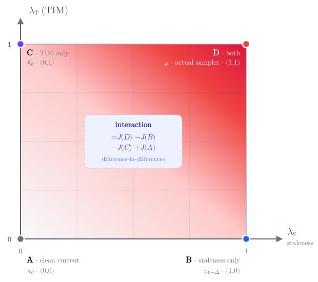
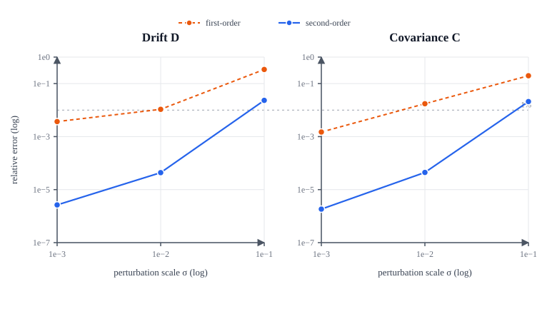
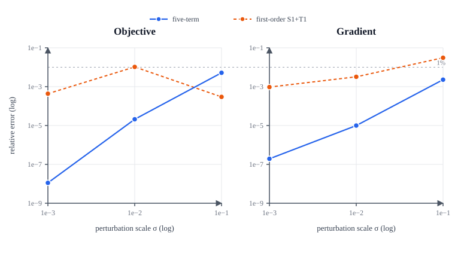

The stability of LLM RL depends heavily on how similar the sampler and the trainer are. Ideally they are the same policy. In practice, one generates in vLLM and the other trains in Megatron, with a parameter lag, precision differences, kernels, quantization, and MoE routing in between. We call these two kinds of discrepancy **staleness** and **TIM**. They are often discussed together, but they are perturbations in two different spaces.

> Staleness is a perturbation in parameter space; TIM is a perturbation in logit space. Jointly, they are still a logit perturbation. This observation turns the “two kinds of mismatch” into a separable decomposition problem.

Since both can be written as the same logit perturbation, we can analyze it along three coordinates:

- **source**: staleness (S) or TIM (T)?
- **mechanism**: drift (a mean shift) or covariance (coupling with the reward)?
- **resolution**: first order, second order, or exact?

The following sections unfold along these three coordinates: §4 is the first-order single-source slice, §5 is the exact joint decomposition (pure staleness + pure TIM + interaction), §6 is the second-order five-term slice, and §7 projects existing methods onto these terms. The single-source analysis sets up the axes, the exact joint decomposition provides ground truth, and the second-order expansion gives an actionable budget.

## Key Takeaways

- **Both mismatches can be written as the same logit perturbation**: a staleness component $\delta z_S$ plus a TIM component $\delta z_T$; the joint perturbation is their sum.
- **The joint effect of staleness and TIM admits an exact 2D decomposition**: both the objective bias and the gradient bias can be written as “pure staleness + pure TIM + interaction,” where the interaction is an integral of a covariance field over the $(\lambda_S,\lambda_T)$ square.
- **The second-order expansion has five terms**: two first-order terms, two second-order self terms, and one cross term $ST$. The first order is additive; $ST$ is the first non-additive term.
- **SC removes only drift**, not covariance; **the IS family is the only class that directly suppresses covariance**; **source reduction is the only class that can distinguish the two sources**.
- **In one sentence**: existing methods divide the labor as “SC handles drift, IS/mask handles covariance, and FP16/router replay handles the source”; $ST$ and second-order covariance still lack explicit treatment.

The **Derivation** blocks below contain supplementary proofs and can be skipped on a first read; the formulas and conclusions in the main text do not depend on them.

## 1. Two Engines, Two Kinds of Mismatch

LLM RL typically separates rollout and training into two engines: a rollout engine (vLLM, SGLang, etc.) generates trajectories, and a trainer (Megatron, FSDP, etc.) computes gradients. Ideally, both are the same policy:

$$
\pi_{\text{sampler}}=\pi_{\text{trainer}}.
$$

In reality, they differ in at least two places:

- **Staleness / off-policyness**: the sampler uses old parameters $\theta_{t-a}$, while the trainer uses the current parameters $\theta_t$. This is a mismatch in **parameter space**.
- **Training-inference mismatch (TIM)**: the sampler and trainer have the same parameters, but differ in kernels, precision, quantization, reduction order, and MoE routing. This is a mismatch in **logit space under identical parameters**.

Let the current parameters be $\theta$, the sampler's old parameters be $\theta'$, and the parameter lag be $\Delta=\theta-\theta'$; let $\mu$ be the sampler distribution and $z_\theta$ the logit; let $\eta$ be the learning rate and $a$ the policy age.

| | Staleness / off-policyness | TIM |
|---|---|---|
| Perturbation space | Parameter space $\Delta=\theta-\theta'$ | Logit space $\delta z_T$ |
| Mathematical form | $\mu=\pi_{\theta-\Delta}$ | $\mu=\mathrm{softmax}(z_\theta+\delta z_T)$ |
| Typical sources | Async training [1,2], replay, long trajectories | FP16/BF16 [7], quantization [1], kernels, MoE routing [9] |
| Behavior with age | $\delta z_S=O(\eta a)$, grows with age | $\delta z_T=O(1)$, independent of age |
| Typical symptoms | Drift accumulates with age, gradient norm grows | Systematic bias, collapse under quantization |

Key observation: **both can be written as logit perturbations, and they add in logit space**. This is the starting point for every decomposition that follows. SC Paper [1] analyzes TIM from the perspective of drift, and Mang&Wang's Blog [2] analyzes async staleness from the perspective of age; this post places both in a single decomposition.

## 2. Minimal Background: Drift and Signal

### 2.1 Policy Gradient

For a prompt $x$, the policy $\pi_\theta(y\mid x)$ generates a response $y$ with reward $R(x,y)$. The objective and gradient are

$$
J(\theta)=\mathbb{E}_{\pi_\theta}[R],
\qquad
g(\theta)=\nabla J(\theta)=\mathbb{E}_{\pi_\theta}[R\,s_\theta], \qquad (1)
$$

where $s_\theta=\nabla_\theta\log\pi_\theta$ is the score. The score has zero mean under its own policy:

$$
\mathbb{E}_{\pi_\theta}[s_\theta\mid x]
=\int \pi_\theta(y\mid x)\,\nabla_\theta\log\pi_\theta(y\mid x)\,dy
=\nabla_\theta\!\int \pi_\theta(y\mid x)\,dy
=\nabla_\theta 1=0,
$$

so the second term of the covariance $\mathrm{Cov}(R,s_\theta)=\mathbb{E}[Rs_\theta]-\mathbb{E}[R]\,\mathbb{E}[s_\theta]$ vanishes, and the on-policy gradient is exactly the covariance between reward and score. Intuitively, only the part of the reward that varies with the sampled token produces gradient: a constant reward, or a baseline that depends only on $x$, leaves the gradient unchanged.

If the data come from a sampler $\mu$ rather than $\pi_\theta$, the actual estimator is

$$
\hat g(\theta;\mu)=\mathbb{E}_\mu[R\,s_\theta]. \qquad (2)
$$

It is generally not equal to $g(\theta)$. How large the gap is, and where it comes from, is the question this article answers.

The derivations below fix a prefix and treat $R$ as a function of the next token, i.e., a per-token view; at the sequence level, one only needs to sum over positions (cross-token compounding is discussed in §9).

### 2.2 Drift and Signal

Perform a covariance decomposition under $\mu$ [1]:

$$
\mathbb{E}_\mu[R\,s_\theta]
=\underbrace{\mathbb{E}_\mu[R]\,\mathbb{E}_\mu[s_\theta]}_{\text{drift }D}
+\underbrace{\mathrm{Cov}_\mu(R,s_\theta)}_{\text{signal}}. \qquad (3)
$$

- **Drift** depends on $R$ only through its mean and carries no information about “which token caused success.” It is a distillation term toward the sampler{{note: Read $\mathbb{E}_\mu[s_\theta]$ as the gradient of a distribution distance: $\mathbb{E}_\mu[s_\theta]=\nabla_\theta\mathbb{E}_\mu[\log\pi_\theta]=-\nabla_\theta\mathrm{KL}(\mu\|\pi_\theta)$. Hence for $\bar R>0$, drift lowers the KL between sampler and trainer and pulls $\pi_\theta$ toward $\mu$ — the same update shape as distillation/SFT. It is weighted only by the mean reward and carries no token-level credit. On-policy, $\mu=\pi_\theta$ and the KL gradient at itself is zero, so drift vanishes.}}; on-policy, $\mathbb{E}_{\pi}[s]=0$, so drift vanishes.
- **Signal** is the actual learning signal, but the covariance is taken under $\mu$, not under $\pi$.

The core insight of Score Centering [1] is that the main cause of RL instability under TIM is not “noise” but drift. The key is whether the behavior policy $\mu$ is fixed: when $\mu$ is fixed (off-policy RL with a fixed behavior policy; SFT is the special case with $R\equiv1$ and zero covariance), drift is the gradient of a fixed KL potential, $-\bar R\nabla_\theta\mathrm{KL}(\mu\|\pi_\theta)$, so it has a fixed point and does not amplify itself. Under TIM/async, $\mu$ is a lagged, biased copy of the trainer, so the KL target moves with the trainer and drift becomes a feedback loop. In synchronous on-policy RL, $\mu=\pi_\theta$ and drift is exactly zero.

Drift is like an invisible teacher that keeps pulling the student toward the sampler.

### 2.3 Score Centering and Importance Sampling

**Score centering (SC) [1]** subtracts the expected score under the sampler:

$$
\tilde s=s_\theta-\mathbb{E}_\mu[s_\theta].
$$

Then

$$
\mathbb{E}_\mu[R\,\tilde s]
=\underbrace{\mathbb{E}_\mu[R]\,\mathbb{E}_\mu[\tilde s]}_{=0}
+\mathrm{Cov}_\mu(R,\tilde s)
=\mathrm{Cov}_\mu(R,s_\theta). \qquad (4)
$$

Drift is removed exactly; what remains is covariance.

**Importance sampling (IS)** instead reweights with the ratio $w=\pi_\theta/\mu$:

$$
\mathbb{E}_\mu[w\,R\,s_\theta]=\mathbb{E}_{\pi_\theta}[R\,s_\theta].
$$

Exact IS is unbiased but high-variance; in practice, truncated IS (TIS) [3] or masked IS (MIS) [4] is commonly used.

### 2.4 Two Empirical Facts about Existing Methods

- SC Paper [1]: under quantization, SC alone can match or outperform IS; under severe staleness, SC+TIS/MIS is best.
- Mang&Wang's Blog [2]: the drift norm grows with age; SC reduces the grad-norm ratio between age-64 and age-0 from 3.24 to 1.54; a state-level KL mask and a KL penalty can further stabilize training.

Behind these phenomena, different terms are being removed. We first fix the notation, then place them in a single expression.

## 3. Notations

> Throughout, $\pi$ denotes the trainer and $\mu$ the sampler (SC Paper uses $p/q$, Mang&Wang's Blog uses $\pi/\mu$; map accordingly when citing). Unsubscripted $\mathbb{E},\mathrm{Cov}$ default to $\pi=\pi_\theta$; $\mathbb{R}$, $\mathrm{softmax}$, $\log$, $\sum$, $\int$ have their usual meanings, and $d$ denotes the differential.

<b>Notation</b>: click to expand

| Symbol | Meaning |
|---|---|
| $x$ | prompt / state (prefix) |
| $v\in\mathcal{V}$ | a token in the vocabulary $\mathcal{V}$; $V=\lvert\mathcal{V}\rvert$ is the vocabulary size |
| $y$ | response (token sequence) |
| $\theta\in\mathbb{R}^P$ | trainer parameters; $P$ is the parameter dimension |
| $\theta'=\theta-\Delta$ | stale sampler parameters; $\Delta$ is the parameter lag |
| $a$ | policy age; $\Delta=O(\eta a)$ |
| $\eta$ | learning rate |
| $t$ | time step / parameter step |
| $z_\theta(v\mid x)$ | logit; $z$ is shorthand |
| $\pi_\theta(v\mid x)$ | trainer policy $=\mathrm{softmax}(z_\theta)_v$; $\pi$ is shorthand |
| $\mu$ | sampler distribution |
| $\tilde\pi_\theta$ | policy after the TIM perturbation $=\mathrm{softmax}(z+\delta z_T)$ |
| $\mathrm{A},\mathrm{B},\mathrm{C},\mathrm{D}$ | the four endpoints of the 2×2 factorial (§5.1); upright, to distinguish them from the italic drift $D$ and covariance $C$ |
| $\delta z_S$ | logit difference due to staleness $=z_{\theta-\Delta}-z_\theta$ |
| $\delta z_T$ | logit difference due to TIM |
| $\delta z$ | total logit perturbation $=\delta z_S+\delta z_T$ |
| $s_\theta(v\mid x)$ | score $=\nabla_\theta\log\pi_\theta$; $s$ is shorthand |
| $R(x,y)$ | reward; in the per-token analysis, after fixing the prefix it is treated as a function of the next token $v$; also used for the advantage (§6.4) |
| $A$ | advantage $=R-\beta(x)$ (§6.4) |
| $\bar A$ | prefix-level average advantage (§6.4) |
| $\beta(x)$ | state-dependent baseline (§6.4) |
| $\bar R$ | $\mathbb{E}_{\pi_\theta}[R]$ |
| $J$ | objective; $J(\theta)=\mathbb{E}_{\pi_\theta}[R]$, with the interpolated version $J(\lambda_S,\lambda_T)=\mathbb{E}_{\pi_{\lambda_S,\lambda_T}}[R]$ (§5.2) |
| $\Delta J,\Delta J_S,\Delta J_T$ | change in the objective and its pure staleness / pure TIM components (§5.2) |
| $g(\theta)$ | true gradient $\nabla J(\theta)$ |
| $G(\lambda_S,\lambda_T)$ | gradient estimator under the interpolated policy $=\mathbb{E}_{\pi_{\lambda_S,\lambda_T}}[Rs_\theta]$ (§5.2) |
| $b$ | gradient bias $=\mathbb{E}_\mu[Rs_\theta]-\mathbb{E}_\pi[Rs_\theta]$ |
| $b_S,b_T,b_{\mathrm{int}}$ | staleness / TIM / interaction components of the gradient bias; first-order truncations in §4, exact components in §5 |
| $b^{(1)}$ | total first-order gradient bias (§4.3) |
| $D$ | drift $=\mathbb{E}_\mu[R]\mathbb{E}_\mu[s_\theta]$ (italic) |
| $C$ | covariance bias $=b-D$ (italic) |
| $D^{(1)},C^{(1)}$ | total first-order drift / covariance bias |
| $H$ | $\mathbb{E}_\pi[Rss^\top]$ |
| $F$ | $\mathbb{E}_\pi[ss^\top]$ (Fisher information) |
| $a_S,a_T$ | centered logit perturbations $\delta z_S-\mathbb{E}_\pi[\delta z_S]$, $\delta z_T-\mathbb{E}_\pi[\delta z_T]$; they vary along the path in the integrals of §5, and are evaluated at the expansion point in §6 |
| $u$ | total centered logit perturbation $=a_S+a_T$ (§6) |
| $\lambda_S,\lambda_T\in[0,1]$ | parameters of the 2D interpolation path |
| $\pi_{\lambda_S,\lambda_T}$ | interpolated policy $=\mathrm{softmax}(z+\lambda_S\delta z_S+\lambda_T\delta z_T)$ |
| $S_1,T_1,S_2,T_2,ST$ | labels for the five terms of §6 (not random variables) |
| $\mathrm{Int}_J$ | interaction term of the objective |
| $D_S^{(1)},C_S^{(1)},D_T^{(1)},C_T^{(1)}$ | first-order drift / covariance components |
| $d_{\mathrm{KL}}(x)$ | state-level KL, i.e., $D_{\mathrm{KL}}(\mu(\cdot\mid x)\|\pi(\cdot\mid x))$ |
| $\tau$ | threshold of the state-KL mask |
| $\nu$ | effective sampling distribution $\propto\mu w$ |
| $w$ | importance weight |
| $W$ | random matrix in Appendix A ($z=W\theta$) |
| $\mathbb{E},\mathrm{Cov}$ | expectation / covariance |
| $O(\cdot)$ | big-O |
| $\top$, $\|\cdot\|$ | transpose / L2 norm |

## 4. Staleness and TIM in Isolation: First-Order Bias

First, fix notation. For a sampler $\mu$, define the gradient bias as

$$
b=\mathbb{E}_\mu[Rs_\theta]-\mathbb{E}_\pi[Rs_\theta].
$$

Section 4 considers two single-source cases: pure staleness ($\mu=\pi_{\theta-\Delta}$), whose bias is $b_S$, and pure TIM (the sampler logits carry an error $\delta z_T$), whose bias is $b_T$. We keep only the first-order term in each case.

### 4.1 Pure Staleness

The sampler uses $\theta-\Delta$ and the trainer uses $\theta$. Let

$$
\delta z_S=z_{\theta-\Delta}-z_\theta
\approx-\Delta^\top\nabla_\theta z.
$$

A first-order expansion of the covariance decomposition in [1] in parameter space gives the first-order gradient bias:

$$
b_S=\mathrm{Cov}_\pi(Rs,\delta z_S)
=-\underbrace{\mathbb{E}_\pi[Rss^\top]}_{H}\Delta
=-H\Delta. \qquad (5)
$$

Two steps are involved: substitute $\delta z_S\approx-\Delta^\top\nabla_\theta z$ and use the score identity $\nabla_\theta z=s_\theta+\mathbb{E}_{\pi_\theta}[\nabla_\theta z]$. The second term is constant across sampled tokens at a fixed prefix and cancels in the covariance; with $\mathbb{E}_\pi[s_\theta]=0$, $\mathrm{Cov}_\pi(Rs,s_\theta)=\mathbb{E}_\pi[Rss_\theta^\top]$.

<b>Derivation</b>: origin of the first-order bias

First, see why $b_S$ is a covariance. Under pure staleness, $\mu=\pi_{\theta-\Delta}=\mathrm{softmax}(z+\delta z_S)$. Expand the numerator and denominator (Taylor expansion of the exponential, $e^x=1+x+O(x^2)$):

$$
e^{\delta z_S}=1+\delta z_S+O(\delta z_S^2),
\qquad
\mathbb{E}_{\pi}[e^{\delta z_S}]
=1+\mathbb{E}_{\pi}[\delta z_S]+O(\delta z_S^2).
$$

Using $(1+x)^{-1}=1-x+O(x^2)$ and multiplying out,

$$
\begin{aligned}
\frac{\mu}{\pi}
&=\frac{e^{\delta z_S}}{\mathbb{E}_{\pi}[e^{\delta z_S}]}\\
&=\frac{1+\delta z_S+O(\delta z_S^2)}
        {1+\mathbb{E}_{\pi}[\delta z_S]+O(\delta z_S^2)}\\
&=(1+\delta z_S)(1-\mathbb{E}_{\pi}[\delta z_S])+O(\delta z_S^2)\\
&=1+\delta z_S-\mathbb{E}_{\pi}[\delta z_S]+O(\delta z_S^2),
\end{aligned}
$$

where the last step drops the second-order cross term $\delta z_S\,\mathbb{E}_{\pi}[\delta z_S]$.

Hence

$$
b_S
=\mathbb{E}_{\pi}\Big[\Big(\frac{\mu}{\pi}-1\Big)Rs_\theta\Big]+O(\Delta^2)
=\mathbb{E}_{\pi}\big[Rs_\theta(\delta z_S-\mathbb{E}_{\pi}[\delta z_S])\big]+O(\Delta^2)
=\mathrm{Cov}_{\pi}(Rs_\theta,\delta z_S)+O(\Delta^2).
$$

Below we rewrite the same step in derivative form. For $p_\epsilon=\mathrm{softmax}(z+\epsilon\,\delta z)$,

$$
\partial_\epsilon\log p_\epsilon=\delta z-\mathbb{E}_{p_\epsilon}[\delta z].
$$

Thus, for any statistic $f$,

$$
\partial_\epsilon\mathbb{E}_{p_\epsilon}[f]
=\mathbb{E}_{p_\epsilon}\big[f\,(\delta z-\mathbb{E}_{p_\epsilon}[\delta z])\big].
$$

Take $f=Rs_\theta$ and the first-order term at $\epsilon=0$ to obtain $b_S=\mathrm{Cov}_\pi(Rs_\theta,\delta z_S)+O(\Delta^2)$. Expanding to first order in $\Delta$, $\delta z_S\approx-\Delta^\top\nabla_\theta z$; and because

$$
s_\theta=\nabla_\theta\log\pi_\theta
=\nabla_\theta z-\mathbb{E}_{\pi_\theta}[\nabla_\theta z],
$$

i.e., the score is the centered logit gradient. Let $c(x)=\mathbb{E}_{\pi_\theta}[\nabla_\theta z]$; at a fixed prefix it is constant across the sampled token, so $\mathrm{Cov}_\pi(Rs_\theta,c(x))=0$. Here $\mathrm{Cov}_\pi(Rs_\theta,\nabla_\theta z)$ is a $P\times P$ cross-covariance matrix, so

$$
\begin{aligned}
b_S
&=\mathrm{Cov}_\pi(Rs_\theta,\delta z_S)\\
&=\mathrm{Cov}_\pi\big(Rs_\theta,-\Delta^\top\nabla_\theta z\big)\\
&=-\mathrm{Cov}_\pi(Rs_\theta,\nabla_\theta z)\,\Delta\\
&=-\mathrm{Cov}_\pi(Rs_\theta,s_\theta)\,\Delta\\
&=-\mathbb{E}_\pi[Rs_\theta s_\theta^\top]\Delta
=-H\Delta.
\end{aligned}
$$

Splitting $H$ below then gives (6).

Split $H$ into a mean part and a covariance part:

$$
H=\bar R\,F+\mathrm{Cov}_\pi(R,ss^\top).
$$

<b>Derivation</b>: splitting H

Substituting $R=\bar R+(R-\bar R)$,

$$
\begin{aligned}
H
&=\mathbb{E}_\pi[Rss^\top]\\
&=\bar R\,\mathbb{E}_\pi[ss^\top]+\mathbb{E}_\pi[(R-\bar R)ss^\top]\\
&=\bar R\,F+\mathrm{Cov}_\pi(R,ss^\top),
\end{aligned}
$$

where $F=\mathbb{E}_\pi[ss^\top]$ and $\mathrm{Cov}_\pi(R,ss^\top)=\mathbb{E}_\pi[(R-\bar R)ss^\top]$.

Thus

$$
b_S=D_S^{(1)}+C_S^{(1)},
\qquad
D_S^{(1)}=-\bar R\,F\Delta,
\qquad
C_S^{(1)}=-\mathrm{Cov}_\pi(R,ss^\top)\Delta. \qquad (6)
$$

Intuitively, drift is “mean reward × Fisher × parameter lag,” and covariance is “fluctuation of reward × lag.”

### 4.2 Pure TIM

The sampler uses the same parameters, but the logit has an error $\delta z_T$. Applying the decomposition in [1] to this pure logit perturbation gives the first-order terms:

$$
b_T=\mathrm{Cov}_\pi(Rs,\delta z_T), \qquad (7)
$$

$$
D_T^{(1)}=\bar R\,\mathrm{Cov}_\pi(s,\delta z_T),
\qquad
C_T^{(1)}=\mathrm{Cov}_\pi\big((R-\bar R)s,\delta z_T\big). \qquad (8)
$$

The key criterion: **to first order, the harm of TIM does not depend on the magnitude of $\|\delta z_T\|$, but on the correlation between $\delta z_T$ and $Rs$**. If the numerical error is independent of the learning signal, even a large error is mostly harmless; if it systematically favors high-reward tokens, even a small error can be fatal. This explains why systematic quantization is more dangerous than unbiased random noise [1,7].

<b>Derivation</b>: drift / covariance split of the TIM bias

Let $a_T=\delta z_T-\mathbb{E}_\pi[\delta z_T]$. Following the first-order formula in §4.1,

$$
b_T=\mathbb{E}_\pi[Rs_\theta a_T].
$$

Split $R=\bar R+(R-\bar R)$:

$$
b_T=\bar R\,\mathbb{E}_\pi[s_\theta a_T]
+\mathbb{E}_\pi[(R-\bar R)s_\theta a_T].
$$

The first term depends on reward only through $\bar R$ and is drift; the second is the covariance between reward fluctuations and the score, i.e., covariance. Since $\mathbb{E}_\pi[a_T]=0$,

$$
\mathbb{E}_\pi[s_\theta a_T]=\mathrm{Cov}_\pi(s_\theta,\delta z_T),
\qquad
\mathbb{E}_\pi[(R-\bar R)s_\theta a_T]
=\mathrm{Cov}_\pi\big((R-\bar R)s_\theta,\delta z_T\big).
$$

This is (8).

### 4.3 First-Order Additivity

Add the first-order terms of the two sources:

$$
b^{(1)}=-H\Delta+\mathrm{Cov}_\pi(Rs,\delta z_T), \qquad (9)
$$

$$
D^{(1)}=-\bar R F\Delta+\bar R\,\mathrm{Cov}_\pi(s,\delta z_T),
$$

$$
C^{(1)}=-\mathrm{Cov}_\pi(R,ss^\top)\Delta
+\mathrm{Cov}_\pi\big((R-\bar R)s,\delta z_T\big).
$$

To first order, staleness and TIM are additive, with no cross term. The problem starts at second order.

## 5. Staleness and TIM Together: An Exact 2D Decomposition

### 5.1 Setup

The actual sampler has both a parameter lag and TIM:

$$
\mu=\mathrm{softmax}\big(z_{\theta-\Delta}+\delta z_T\big).
$$

Let

$$
\delta z_S:=z_{\theta-\Delta}-z_\theta,
\qquad
\delta z:=\delta z_S+\delta z_T. \qquad (10)
$$

Note that $\delta z_S$ here is the **exact logit difference**; the first-order analysis in §4 uses its linearization $-\Delta^\top\nabla_\theta z$. The two sources add in logit space, and all nonlinearity comes from the softmax and the expectations.

For $\lambda_S,\lambda_T\in[0,1]$, define the interpolated policy:

$$
\pi_{\lambda_S,\lambda_T}:=\mathrm{softmax}\big(z+\lambda_S\delta z_S+\lambda_T\delta z_T\big).
$$

The endpoints can be represented by a 2×2 table:

| | TIM = 0 | TIM = $\delta z_T$ |
|---|---|---|
| staleness = 0 | $\mathrm{A}=\pi_\theta$ | $\mathrm{C}=\tilde\pi_\theta$ |
| staleness = $\Delta$ | $\mathrm{B}=\pi_{\theta-\Delta}$ | $\mathrm{D}=\mu$ |

**Table 1**: The four endpoints of the 2×2 factorial. A has no mismatch, B has only staleness, C has only TIM, and D has both (the actual sampler).

Write the objective of the interpolated policy as

$$
J(\lambda_S,\lambda_T)=\mathbb{E}_{\pi_{\lambda_S,\lambda_T}}[R],
$$

and abbreviate the four endpoint values as $J(\mathrm{A})=J(0,0)$, $J(\mathrm{B})=J(1,0)$, $J(\mathrm{C})=J(0,1)$, and $J(\mathrm{D})=J(1,1)$. Define

$$
\Delta J_S=J(\mathrm{B})-J(\mathrm{A}),\qquad
\Delta J_T=J(\mathrm{C})-J(\mathrm{A}),\qquad
\mathrm{Int}_J=J(\mathrm{D})-J(\mathrm{B})-J(\mathrm{C})+J(\mathrm{A}).
$$

$\mathrm{Int}_J$ is the **interaction**: the part of the objective that exceeds the sum of the two single-source effects when both mismatches are present, i.e., the four-corner difference-in-differences.

Here **2D** refers to the two interpolation parameters $(\lambda_S,\lambda_T)\in[0,1]^2$: $\lambda_S$ controls the strength of staleness and $\lambda_T$ controls the strength of TIM. Viewing the two mismatch sources as two coordinate axes of a plane, the four endpoints are A/B/C/D; interaction can also be written as the integral of the mixed partial $\partial_{\lambda_S}\partial_{\lambda_T}J$ over this unit square.

**Figure 1**: The $(\lambda_S,\lambda_T)$ plane. The horizontal axis is staleness strength $\lambda_S$ and the vertical axis is TIM strength $\lambda_T$; A is the origin, B is pure staleness, C is pure TIM, and D is their superposition. The interaction $\mathrm{Int}_J=J(\mathrm{D})-J(\mathrm{B})-J(\mathrm{C})+J(\mathrm{A})$ is the four-corner difference-in-differences.

> **Side note.** The path here is a linear interpolation in logit space. The four endpoints are fixed, so the $\Delta J_S,\Delta J_T,\mathrm{Int}_J$ defined above are determined solely by the endpoints and are independent of the interpolation path. The path changes only how the integrand (the covariance field) is distributed over the square, not the values of the three integrals.

### 5.2 Exact Decomposition

Building on the drift/covariance decomposition in [1], differentiate the $J(\lambda_S,\lambda_T)$ defined above. Recall the centered perturbations at the interpolation point $\pi_{\lambda_S,\lambda_T}$:

$$
a_S=\delta z_S-\mathbb{E}_{\pi_{\lambda_S,\lambda_T}}[\delta z_S],
\qquad
a_T=\delta z_T-\mathbb{E}_{\pi_{\lambda_S,\lambda_T}}[\delta z_T].
$$

Then

$$
\partial_{\lambda_S}J=\mathbb{E}[R a_S],
\qquad
\partial_{\lambda_T}J=\mathbb{E}[R a_T],
$$

$$
\partial_{\lambda_S}\partial_{\lambda_T}J
=\mathrm{Cov}(R,a_S a_T).
$$

Here $\mathbb{E}$ and $\mathrm{Cov}$ are both under $\pi_{\lambda_S,\lambda_T}$; the subscript is omitted for brevity.

<b>Derivation</b>: 2D decomposition and mixed partials

For $\pi_\lambda=\mathrm{softmax}(z+\lambda_S\delta z_S+\lambda_T\delta z_T)$,

$$
\partial_{\lambda_S}\log\pi_\lambda=\delta z_S-\mathbb{E}_{\pi_\lambda}[\delta z_S]=a_S,
$$

so for any $f$,

$$
\partial_{\lambda_S}\mathbb{E}_{\pi_\lambda}[f]=\mathbb{E}_{\pi_\lambda}[f a_S].
$$

Differentiate once more with respect to $\lambda_T$:

$$
\partial_{\lambda_T}\mathbb{E}_{\pi_\lambda}[f a_S]
=\mathbb{E}_{\pi_\lambda}[f a_S a_T]
+\mathbb{E}_{\pi_\lambda}[f\,\partial_{\lambda_T}a_S].
$$

From $a_S=\delta z_S-\mathbb{E}_{\pi_\lambda}[\delta z_S]$, we have $\partial_{\lambda_T}a_S=-\mathbb{E}_{\pi_\lambda}[a_S a_T]$, so

$$
\partial_{\lambda_S}\partial_{\lambda_T}\mathbb{E}_{\pi_\lambda}[f]
=\mathbb{E}[f a_S a_T]-\mathbb{E}[f]\,\mathbb{E}[a_S a_T]
=\mathrm{Cov}_{\pi_\lambda}(f,a_S a_T).
$$

Taking $f=R$ gives the mixed partial of the objective; taking $f=Rs_\theta$ (with $s_\theta$ fixed as the trainer score) gives the mixed partial of the gradient.

Finally, apply the two-dimensional Newton–Leibniz formula over the square:

$$
J(1,1)-J(0,0)
=\big[J(1,0)-J(0,0)\big]
+\big[J(0,1)-J(0,0)\big]
+\int_0^1\!\!\int_0^1\partial_{\lambda_S}\partial_{\lambda_T}J\,d\lambda_S\,d\lambda_T.
$$

This is (11); replacing $J$ by $G$ gives (12). All three quantities on the right are determined solely by the four corners, consistent with the side note in §5.1.

Therefore, **exactly**,

$$
\Delta J:=\mathbb{E}_\mu[R]-\mathbb{E}_\pi[R]
=\underbrace{\Delta J_S}_{\text{staleness}}
+\underbrace{\Delta J_T}_{\text{TIM}}
+\underbrace{\mathrm{Int}_J}_{\text{interaction}}, \qquad (11)
$$

where

$$
\Delta J_S=\int_0^1\mathbb{E}_{\pi_{\lambda_S,0}}[R a_S]\,d\lambda_S,
$$

$$
\Delta J_T=\int_0^1\mathbb{E}_{\pi_{0,\lambda_T}}[R a_T]\,d\lambda_T,
$$

$$
\mathrm{Int}_J=\int_0^1\int_0^1
\mathrm{Cov}_{\pi_{\lambda_S,\lambda_T}}(R,a_S a_T)\,
d\lambda_S\,d\lambda_T.
$$

For the gradient estimator $G(\lambda_S,\lambda_T)=\mathbb{E}_{\pi_{\lambda_S,\lambda_T}}[Rs_\theta]$ (with $s_\theta$ fixed as the trainer score):

$$
b:=\mathbb{E}_\mu[Rs_\theta]-\mathbb{E}_\pi[Rs_\theta]
=b_S+b_T+b_{\mathrm{int}}, \qquad (12)
$$

$$
b_S=\int_0^1\mathbb{E}_{\pi_{\lambda_S,0}}[Rs_\theta a_S]\,d\lambda_S,
\qquad
b_T=\int_0^1\mathbb{E}_{\pi_{0,\lambda_T}}[Rs_\theta a_T]\,d\lambda_T,
$$

$$
b_{\mathrm{int}}=\int_0^1\int_0^1
\mathrm{Cov}_{\pi_{\lambda_S,\lambda_T}}(Rs_\theta,a_S a_T)\,
d\lambda_S\,d\lambda_T.
$$

Here $b_S,b_T,b_{\mathrm{int}}$ are exact components; the $b_S,b_T$ in §4 are their first-order truncations ($O(\Delta)$ and $O(\delta z_T)$, respectively).

The expression above is **exact** for any $\Delta,\delta z_T$; it is not a Taylor approximation. It is suitable as a benchmark under severe quantization, and it also reveals the structure of interaction: **it is the integral of the covariance between $R$ (or $Rs_\theta$) and $a_Sa_T$ over the $(\lambda_S,\lambda_T)$ square**.

## 6. Second-Order Approximation of the Joint Error

### 6.1 The Five Terms

Expand at $\lambda_S=\lambda_T=0$ and let $u=a_S+a_T$ ($u$ is the total centered perturbation, distinct from the policy age $a$). The gradient bias can be written as

$$
b=\underbrace{S_1+T_1}_{\text{first order}}
+\underbrace{S_2+T_2+ST}_{\text{second order}}
+O(\delta z^3), \qquad (13)
$$

where:

| Term | Expression | Order | Meaning |
|---|---|---|---|
| $S_1$ | $\mathbb{E}_\pi[Rs_\theta a_S]$ | $O(\Delta)$ | first-order staleness |
| $T_1$ | $\mathbb{E}_\pi[Rs_\theta a_T]$ | $O(\delta z_T)$ | first-order TIM |
| $S_2$ | $\frac12\mathbb{E}_\pi[Rs_\theta(a_S^2-\mathbb{E}a_S^2)]$ | $O(\Delta^2)$ | second-order staleness |
| $T_2$ | $\frac12\mathbb{E}_\pi[Rs_\theta(a_T^2-\mathbb{E}a_T^2)]$ | $O(\delta z_T^2)$ | second-order TIM |
| $ST$ | $\mathbb{E}_\pi[Rs_\theta(a_Sa_T-\mathbb{E}[a_Sa_T])]$ | $O(\Delta\delta z_T)$ | cross term |

**Table 2**: The five-term expansion. $S_1,T_1$ are first order; $S_2,T_2,ST$ are second order. $ST$ is the second-order truncation of $\mathrm{Int}_J$ in §5; $\mathrm{Int}_J$ also contains higher-order cross terms.

The expansion of the objective is identical, replacing $Rs_\theta$ by $R$:

$$
\Delta J=S_1+T_1+S_2+T_2+ST+O(\delta z^3).
$$

<b>Derivation</b>: five-term expansion

Again use $p_\epsilon=\mathrm{softmax}(z+\epsilon\,\delta z)$ and let $u=\delta z-\mathbb{E}_\pi[\delta z]=a_S+a_T$. Perform a second-order Taylor expansion of $\mathbb{E}_{p_\epsilon}[f]$ at $\epsilon=0$:

$$
\mathbb{E}_{p_1}[f]-\mathbb{E}_\pi[f]
=\mathbb{E}_\pi[f u]
+\frac12\mathbb{E}_\pi\big[f(u^2-\mathbb{E}_\pi[u^2])\big]
+O(\delta z^3).
$$

(The first-order term is $\mathbb{E}[fu]$ from the previous section; the second-order term comes from differentiating $\partial_\epsilon\mathbb{E}_{p_\epsilon}[f]=\mathbb{E}_{p_\epsilon}[fu]$ once more, using $\partial_\epsilon u=-\mathbb{E}_{p_\epsilon}[u^2]$.)

Substitute $u=a_S+a_T$, so $u^2=a_S^2+2a_Sa_T+a_T^2$, and take $f=Rs_\theta$:

$$
\mathbb{E}[Rs_\theta u]=S_1+T_1,
$$

$$
\frac12\mathbb{E}\big[Rs_\theta(u^2-\mathbb{E}u^2)\big]
=S_2+T_2+ST.
$$

The coefficient of the cross term is $\frac12\cdot 2=1$. Taking $f=R$ gives the same five terms for the objective.

### 6.2 Why Second Order If the First Order Is Additive?

- $S_1+T_1$ is the additive first-order part.
- $S_2,T_2$ are second-order corrections from **pure sources**: they remain even if the other source is zero.
- $ST$ is the first term that couples the two sources, of order $O(\Delta\delta z_T)$.

Two special cases:

- $\delta z_T=0$: $T_1=T_2=ST=0$, leaving only $S_1+S_2$ (second-order pure staleness).
- $\delta z_S=0$: $S_1=S_2=ST=0$, leaving only $T_1+T_2$ (second-order pure TIM).

### 6.3 Drift / Covariance Split

For the total bias $b$, the drift is $D=\mathbb{E}_\mu[R]\mathbb{E}_\mu[s_\theta]$. To second order:

$$
D=\bar R\,\mathbb{E}[s u]
+\frac12\bar R\,\mathbb{E}[s(u^2-\mathbb{E}u^2)]
+\mathbb{E}[R u]\,\mathbb{E}[s u]
+O(\delta z^3). \qquad (14)
$$

The covariance bias $C=b-D$ is

$$
C=\mathbb{E}[(R-\bar R)s u]
+\frac12\mathbb{E}[(R-\bar R)s(u^2-\mathbb{E}u^2)]
-\mathbb{E}[R u]\,\mathbb{E}[s u]
+O(\delta z^3). \qquad (15)
$$

Note that $C=b-D=\mathrm{Cov}_\mu(R,s_\theta)-g$: it is the deviation of the signal in §2.2 from the true gradient.

<b>Derivation</b>: second-order expansion of drift

Expand both factors to second order at $\pi$:

$$
\mathbb{E}_\mu[R]
=\bar R+\mathbb{E}_\pi[Ru]
+\frac12\mathbb{E}_\pi\big[R(u^2-\mathbb{E}_\pi[u^2])\big]
+O(\delta z^3),
$$

$$
\mathbb{E}_\mu[s_\theta]
=\mathbb{E}_\pi[s_\theta u]
+\frac12\mathbb{E}_\pi\big[s_\theta(u^2-\mathbb{E}_\pi[u^2])\big]
+O(\delta z^3),
$$

using $\mathbb{E}_\pi[s_\theta]=0$. Multiply the two expressions and keep terms through second order:

$$
D=\mathbb{E}_\mu[R]\,\mathbb{E}_\mu[s_\theta]
=\bar R\,\mathbb{E}[s u]
+\frac12\bar R\,\mathbb{E}[s(u^2-\mathbb{E}u^2)]
+\mathbb{E}[R u]\,\mathbb{E}[s u]
+O(\delta z^3),
$$

which is (14). Subtracting $D$ from $b=\mathbb{E}[Rsu]+\frac12\mathbb{E}[Rs(u^2-\mathbb{E}u^2)]+O(\delta z^3)$ gives (15).

Keeping only the first-order terms (from (5) and (8)):

$$
D^{(1)}=-\bar R F\Delta+\bar R\,\mathrm{Cov}(s,\delta z_T),
$$

$$
C^{(1)}=-\mathrm{Cov}(R,ss^\top)\Delta+\mathrm{Cov}((R-\bar R)s,\delta z_T),
$$

$$
b^{(1)}=D^{(1)}+C^{(1)}
=\underbrace{-H\Delta}_{\text{drift}}+\underbrace{\mathrm{Cov}(Rs,\delta z_T)}_{\text{covariance}}. \qquad (16)
$$

### 6.4 Advantage Version

If training uses an advantage $A=R-\beta(x)$ (with $\beta$ depending only on the state), replace $R$ above by $A$ and $\bar R$ by the prefix-level $\bar A$. Since $A-\bar A=R-\bar R$, the covariance terms are invariant to a state-dependent baseline.

## 7. Existing Methods: Who Removes Which Term

We first fix the notation: $b=S_1+T_1+S_2+T_2+ST+O(\delta z^3)$, with first-order terms $S_1=D_S^{(1)}+C_S^{(1)}$ and $T_1=D_T^{(1)}+C_T^{(1)}$. In the tables, ✓ = exact removal (within the method's target regime); ◐ = partial removal (e.g., only on the retained mass); ✗ = no removal; ↑ = adds back a controlled term.

Abbreviations: IS = importance sampling; TIS/MIS = truncated/masked IS; PPO/DAPO/GSPO = ratio-clipping methods; DPPO = TV mask; TRM = trust-region masking; SC = score centering. The $\nu\propto\mu w$ in the tables is the effective distribution after IS reweighting, and the retained mass is the mass it covers.

Method sources: TIS [3], MIS/IcePop [4], DPPO [5], TRM [8], and FP16/router replay [7,9] come from the corresponding papers; SC and baseline correction come from [1]; the state-KL mask and KL penalty come from Mang&Wang's Blog [2]; PPO/DAPO/GSPO are standard ratio-clipping methods (DAPO [10], GSPO [11]). CIS [6] is not in the tables: it performs confidence-aware truncation from the perspective of log-odds shifts, which is complementary to the $\delta z$ decomposition here; we return to it in §9. We care only about the effect of these methods on bias, not about their concrete implementations.

We first look at the $D^{(1)}/C^{(1)}$ view (who removes drift and who removes covariance), and then break the analysis down into the five terms (which specific term is removed). “SC+TIS/MIS” in the tables means centering on the weighted score, i.e., the combination used in Appendix A.2 of SC Paper [1]; it is not “SC first, then IS.” The ordering issue is discussed in §7.4.

### 7.1 D/C View

| Method | $D_S^{(1)}$ | $C_S^{(1)}$ | $D_T^{(1)}$ | $C_T^{(1)}$ | Notes |
|---|---|---|---|---|---|
| Vanilla PG | ✗ | ✗ | ✗ | ✗ | keeps everything |
| Exact IS | ✓ | ✓ | ✓ | ✓ | unbiased |
| TIS [3] | ◐ | ◐ | ◐ | ◐ | retained mass |
| MIS/IcePop [4] | ◐ | ◐ | ◐ | ◐ | retained mass + selection |
| PPO/DAPO/GSPO [10,11] | ◐ | ◐ | ◐ | ◐ | clipping only; does not distinguish sources |
| DPPO [5] | ◐ | ◐ | ◐ | ◐ | TV mask |
| **SC** [1] | ✓ | ✗ | ✓ | ✗ | **removes drift, leaves covariance** |
| SC+TIS/MIS [1,3,4] | ✓ | ◐ | ✓ | ◐ | SC on weighted scores: drift exactly zero; covariance under $\nu$ |
| state-KL mask [2] | ◐ | ◐ | ◐ | ◐ | per-state |
| TRM [8] | ◐ | ◐ | ◐ | ◐ | per-sequence |
| Baseline correction [1] | ✓ | ✗ | ✓ | ✗ | dual to SC |
| Explicit KL penalty [2] | ↑ | ✗ | ↑ | ✗ | adds back controlled drift |
| FP16 / router replay [7,9] | ✗ | ✗ | ◐ | ◐ | reduces only the TIM source |
| reduce age / fresh data [1,2] | ◐ | ◐ | ✗ | ✗ | reduces only the staleness source |
| Exact match | ✓ | ✓ | ✓ | ✓ | not practical |

**Table 3**: The $D^{(1)}/C^{(1)}$ view. ✓ = removes; ◐ = partially removes; ✗ = does not remove; ↑ = adds back a controlled term.

### 7.2 Five-Term View

| Method | Mechanism | $S_1$ | $T_1$ | $S_2$ | $T_2$ | $ST$ | Notes |
|---|---|---|---|---|---|---|---|
| Vanilla PG | no correction | ✗ | ✗ | ✗ | ✗ | ✗ | keeps everything |
| Exact IS | full-vocabulary ratio | ✓ | ✓ | ✓ | ✓ | ✓ | unbiased but high variance |
| TIS [3] | truncated ratio | ◐ | ◐ | ◐ | ◐ | ◐ | retained mass; truncated residual |
| MIS/IcePop [4] | mask out-of-band | ◐ | ◐ | ◐ | ◐ | ◐ | drops samples; selection bias |
| PPO/DAPO/GSPO [10,11] | clip ratio | ◐ | ◐ | ◐ | ◐ | ◐ | clipping only; does not distinguish sources |
| DPPO [5] | TV mask | ◐ | ◐ | ◐ | ◐ | ◐ | filters positions by TV |
| **SC** [1] | subtract $\mathbb{E}_\mu[s]$ | ◐ | ◐ | ◐ | ◐ | ◐ | **removes drift only**; leaves all covariance |
| SC+TIS/MIS [1,3,4] | SC on weighted scores | ◐ | ◐ | ◐ | ◐ | ◐ | drift exactly zero; covariance under $\nu$ |
| state-KL mask [2] | $d_{\mathrm{KL}}(x)>\tau$ | ◐ | ◐ | ◐ | ◐ | ◐ | per-state; does not distinguish sources |
| TRM [8] | sequence KL mask | ◐ | ◐ | ◐ | ◐ | ◐ | per-sequence |
| Baseline correction [1] | prefix-level baseline | ◐ | ◐ | ◐ | ◐ | ◐ | removes drift only; dual to SC |
| Explicit KL penalty [2] | KL regularization | ✗ | ✗ | ✗ | ✗ | ✗ | does not remove bias; adds back controlled drift |
| FP16 / router replay [7,9] | reduce $\delta z_T$ | ✗ | ◐ | ✗ | ◐ | ◐ | reduces only the TIM source |
| reduce age / fresh data [1,2] | reduce $\Delta$ | ◐ | ✗ | ◐ | ✗ | ◐ | reduces only the staleness source |
| Exact match | $\mu=\pi$ | ✓ | ✓ | ✓ | ✓ | ✓ | not practical |

**Table 4**: The five-term view. ✓ = exact removal; ◐ = partial removal; ✗ = no removal.

### 7.3 Why Is SC Not Enough?

1. **SC is not “removing $S_1+T_1$.”** It subtracts $\mathbb{E}_\mu[s]$ and exactly removes drift $D$, so $D_S^{(1)},D_T^{(1)}$ vanish; however, $C_S^{(1)},C_T^{(1)}$ remain as they were, and at second order it also removes only the drift part, not the covariance part. This is the structural reason why “instability remains after SC.”
2. **The IS family is the only class that directly suppresses covariance.** Exact IS removes everything; TIS/MIS restrict the residual to the truncated/masked region and only partially correct covariance on the retained mass. This explains the finding of SC Paper [1] that “SC+TIS/MIS is best under severe staleness”: $C_S^{(1)}$ grows with age, SC cannot suppress it, and IS can suppress part of it.
3. **Only source reduction can distinguish $S$ from $T$.** FP16 [7] / router replay [9] reduce $\delta z_T$ and affect only $T_1,T_2,ST$; reducing age reduces $\Delta$ and affects only $S_1,S_2,ST$. Neither handles the other source.
4. **Clipping/masking methods do not distinguish sources.** PPO/DAPO/DPPO/state-KL/TRM all either clip the magnitude of $\delta z$ or remove positions with high mismatch, so all five terms are ◐. The PPO/DAPO clip is designed for the policy-movement ratio; under numerical mismatch, the ratio of a rare token can explode because of a tiny probability difference, and clipping then misses the target. This corresponds to the observation of SC Paper [1] that “PPO/DAPO withstands staleness but not quantization.”
5. **The KL penalty is not a bias-correction term.** It adds back a controlled drift (↑), pulling $\pi$ toward $\mu$ as a trust-region anchor; it does not remove any of the five terms.
6. **Gap**: no method currently targets $ST$ or second-order covariance explicitly; these are only affected incidentally by clipping, masking, or source reduction.

### 7.4 Mapping to Experiments

- **Quantization in SC Paper [1]**: mainly creates $\delta z_T$. SC removes $D_T^{(1)}$ and leaves $C_T^{(1)}$; TIS/MIS suppress only $C_T$ on the retained mass. Under quantization, SC alone or combined with TIS/MIS is best; when mild, SC alone suffices.
- **Staleness in SC Paper [1]**: $\Delta$ dominates. SC removes $D_S^{(1)}$ and leaves $C_S^{(1)}$; TIS/MIS suppress $C_S$. This explains “SC+TIS/MIS is best under staleness, better than vanilla SC.”
- **State-KL mask in Mang&Wang's Blog [2]**: a per-state bound that suppresses the per-state contribution of high $d_{\mathrm{KL}}(x)$, but does not distinguish sources; the **KL penalty** is a trust-region anchor, not a bias correction.
- **The SC+IS critique in Mang&Wang's Blog [2]**: the two operations do not commute. SC→IS adds drift back (centering uses the expectation under $\mu$, while IS changes the measure to $\pi$, leaving a residual of $-\bar R\,\mathbb{E}_\mu[s]$); with IS→Exact IS, SC has no effect; with IS→TIS, SC acts only on the effective distribution $\nu$, and there is no guarantee that $\nu$ is closer to $\pi$.

## 8. What This Means for Method Design

### 8.1 A Regime Map

| Regime | Dominant terms | Are existing methods enough? | Recommendation |
|---|---|---|---|
| Small age, small TIM | $S_1,T_1$ | first order is additive; SC or TIS suffices | start with SC |
| Large age, small TIM | $S_1,S_2$ | SC removes drift, leaves $C_S$ | SC + IS/mask; watch covariance |
| Small age, severe TIM | $T_1,T_2$ | SC removes drift, leaves $C_T$ | SC + IS/mask; match kernels |
| Large age, severe TIM | all five terms | no method targets $ST$ | no explicit treatment yet |

**Table 5**: The regime map. Rows are different mismatch regimes; columns are practical recommendations.

### 8.2 Practical Recommendations

- **Match the engines when possible**: FP16 [7], router replay [9], and batch-invariant kernels are among the few tools that cleanly suppress $T$.
- **Use SC [1] as the default drift correction**: it is cheap, additive, and avoids the multiplicative noise of IS; do not expect it to remove covariance.
- **Use IS/mask [3,4] for covariance correction**: Exact IS removes everything but has high variance; TIS/MIS are trade-offs on the retained mass.
- **Do not use the KL penalty [2] as a bias correction**: it is a trust-region anchor that controls the distance between $\pi$ and $\mu$, not a tool for removing bias.

## 9. Limitations and Open Questions

1. **First/second-order expansions**: accurate when $\delta z$ is small; under severe quantization [1], second-order terms become large.
2. **Logit-perturbation assumption**: the sampler and trainer share $z$ and differ only by $\delta z$. Different tokenizers or architectures do not satisfy this; MoE routing is a discrete jump [9]. CIS [6] makes a continuous approximation from the perspective of log-odds shifts, complementary to the $\delta z$ view here.
3. **Path attribution**: the three integral quantities are determined solely by the four corners and are independent of the interpolation path (see the side note in §5.1); the integrand covariance field, however, depends on the path. If one cares about local attribution such as “which segment of $\lambda$ contributes the interaction,” the path must be fixed; this post uses linear logit interpolation.
4. **Sequence level**: this is a per-token analysis; cross-token terms for long sequences are not computed. If positions are independent, summing over positions suffices; if there is compounding, additional treatment is needed.
5. **Estimation variance**: this post focuses on bias; the estimation variance of $S_2,T_2,ST$ and the variance trade-off with IS are not developed.
6. **Open question**: the magnitudes of $ST$ and second-order covariance in real training still need to be established by 0.6B/30B experiments.

If this article can leave you with only one sentence, let it be this: **existing methods are not competing along a single dimension; they divide the labor of removing different terms**. SC handles drift, IS/mask handles covariance, FP16/router replay handles the source; $ST$ and second-order covariance still lack explicit treatment.

## Appendix A: Numerical Checks

<b>Show appendix</b>

This section is an **algebraic self-check**, not an empirical evaluation. It uses a small softmax only to verify that the decompositions in §4–§6 agree with direct computation; it does not verify the magnitudes of these formulas on real LLMs.

### A.1 Setting

- $V=7$ (vocabulary size), $P=4$ (parameter dimension);
- Random $W\in\mathbb{R}^{V\times P}$, $\theta\in\mathbb{R}^P$, $R\in\mathbb{R}^V$ (fixed seed);
- $z=W\theta$, $\pi=\mathrm{softmax}(z)$, $s_v=W_v-\mathbb{E}_\pi[W]$;
- **Scale sweep**: each component of $\delta z_S,\delta z_T$ is drawn independently from $\mathcal{N}(0,\sigma^2)$, with $\sigma=10^{-3},10^{-2},10^{-1}$; this tests arbitrary logit perturbations without relying on a linear parametrization;
- **Parameter-space check**: draw each component of $\Delta\sim\mathcal{N}(0,\sigma^2)$ separately, set $\delta z_S=-W\Delta$ (which is the exact staleness logit difference under the linear map), and draw $\delta z_T$ as above.

### A.2 Procedure

1. **Exact D/C**: $D=\bar R_\mu\bar s_\mu$, $C=b-D$, where $\bar R_\mu=\mathbb{E}_\mu[R]$, $\bar s_\mu=\mathbb{E}_\mu[s_\theta]$, and $b=\mathbb{E}_\mu[Rs_\theta]-\mathbb{E}_\pi[Rs_\theta]$.
2. **D-C (drift/covariance) first/second order**: $D^{(1)}=\bar R\,\mathbb{E}_\pi[su]$, $C^{(1)}=\mathbb{E}_\pi[(R-\bar R)su]$; use (14)(15) for second order; $u=a_S+a_T$.
3. **Five terms**: evaluate $S_1,T_1,S_2,T_2,ST$ at the expansion point and sum them.
4. **First-order total bias**: compute only $S_1+T_1$.
5. **Interaction**: numerically integrate $\mathrm{Cov}(R,a_Sa_T)$ on an $80\times80$ grid over $(\lambda_S,\lambda_T)\in[0,1]^2$, and compare with the exact difference-in-differences $J(1,1)-J(1,0)-J(0,1)+J(0,0)$.

We first look at D-C, then at the five terms.

### A.3 Drift/Covariance (D-C) View Checks

Using the definitions above, we first examine how the relative error of D-C varies with $\sigma$.

**Figure 2**: Relative error of the D-C view as a function of perturbation scale $\sigma$ (log-log). Left: drift $D$; right: covariance $C$. Solid lines are second order $D^{(2)},C^{(2)}$, dashed lines are first order $D^{(1)},C^{(1)}$, and the gray dashed line is the 1% reference.

| $\sigma$ | err $D^{(1)}$ | err $D^{(2)}$ | err $C^{(1)}$ | err $C^{(2)}$ |
|---|---|---|---|---|
| $10^{-3}$ | $3.7\times10^{-3}$ | $2.7\times10^{-6}$ | $1.5\times10^{-3}$ | $1.8\times10^{-6}$ |
| $10^{-2}$ | $1.1\times10^{-2}$ | $4.4\times10^{-5}$ | $1.7\times10^{-2}$ | $4.5\times10^{-5}$ |
| $10^{-1}$ | $3.4\times10^{-1}$ | $2.3\times10^{-2}$ | $2.0\times10^{-1}$ | $2.1\times10^{-2}$ |

**Component and parameter-space checks ($\sigma=10^{-2}$)**:

| Check | Relative error |
|---|---|
| $D^{(1)}$ vs $D_S^{(1)}+D_T^{(1)}$ | $\sim10^{-16}$ |
| $C^{(1)}$ vs $C_S^{(1)}+C_T^{(1)}$ | $\sim10^{-16}$ |
| $D_S^{(1)}$ vs $-\bar R F\Delta$ | $\sim10^{-16}$ |
| $C_S^{(1)}$ vs $-\mathrm{Cov}(R,ss^\top)\Delta$ | $\sim10^{-16}$ |
| $D_T^{(1)}$ vs $\bar R\mathrm{Cov}(s,\delta z_T)$ | $\sim10^{-16}$ |
| $C_T^{(1)}$ vs $\mathrm{Cov}((R-\bar R)s,\delta z_T)$ | $\sim10^{-16}$ |

**First-order errors of the pure sources ($\sigma=10^{-2}$)**:

| Source | err $D^{(1)}$ | err $C^{(1)}$ |
|---|---|---|
| staleness | $3.3\times10^{-2}$ | $7.1\times10^{-3}$ |
| TIM | $6.4\times10^{-3}$ | $3.0\times10^{-3}$ |

**How to read this**:

- The errors of first-order $D,C$ are relative errors of order $O(\delta z)$; for second-order $D,C$, they drop to $O(\delta z^2)$.
- The parameter-space form and the centered-perturbation form agree to machine precision. This shows that $-\bar R F\Delta$, $-\mathrm{Cov}(R,ss^\top)\Delta$, $\bar R\mathrm{Cov}(s,\delta z_T)$, and $\mathrm{Cov}((R-\bar R)s,\delta z_T)$ in the table of §7.1 are not slogans but equivalent ways of writing the same object.
- The covariance in $C_T^{(1)}$ must subtract $g\,\mathbb{E}[\delta z_T]$; this is required by the definition of $\mathrm{Cov}((R-\bar R)s,\delta z_T)$. It is easy to omit in an implementation, and the numerical difference is large; after adding it, the result returns to machine precision ($\sim10^{-16}$).
- This check also explains the meaning of the table in §7.1: SC removes $D$ and leaves $C$, not “removes $S_1+T_1$”; both $D$ and $C$ are objects that can be verified numerically.

### A.4 Five-Term View Checks

Now examine the five-term expansion of the total bias.

**Figure 3**: Relative error of the algebraic self-check as a function of perturbation scale $\sigma$ (log-log). Left: objective; right: gradient. Solid lines are the five-term expansion, dashed lines are first order $S_1+T_1$, and the gray dashed line is the 1% reference. The first-order objective error bends downward at $\sigma=10^{-1}$, a coincidence caused by cancellation between second-order terms.

| Check | Setting | Relative error |
|---|---|---|
| objective five terms vs exact | $\sigma=10^{-3}/10^{-2}/10^{-1}$ | $1.1\times10^{-8}$ / $2.1\times10^{-5}$ / $5.2\times10^{-3}$ |
| objective first order vs exact | same | $4.4\times10^{-4}$ / $1.0\times10^{-2}$ / $3.0\times10^{-4}$ |
| interaction integral vs exact | $\sigma=0.05/0.2$ | $1.7\times10^{-5}$ / $4.1\times10^{-4}$ |
| gradient five terms vs exact | $\sigma=10^{-3}/10^{-2}/10^{-1}$ | $1.9\times10^{-7}$ / $1.0\times10^{-5}$ / $2.3\times10^{-3}$ |
| gradient first order vs exact | same | $9.5\times10^{-4}$ / $3.2\times10^{-3}$ / $3.1\times10^{-2}$ |

**How to read this**:

- **The five-term expansion is very accurate at $\sigma=10^{-2}$**: the relative error of the objective is about $10^{-5}$, and that of the gradient is also about $10^{-5}$, showing that the algebraic implementation in §5–§6 is correct.
- **At $\sigma=10^{-1}$, second-order terms become significant**: the five-term objective error rises to about $5\times10^{-3}$, and the gradient error to about $2\times10^{-3}$.
- **The interaction integral agrees with difference-in-differences**: the relative error is about $10^{-5}$–$10^{-4}$ (mainly grid discretization error), showing that the 2D decomposition in §5 is not a symbolic game and that the two objects are the same quantity.
- **The error of the first-order formula mainly comes from second-order terms**: when $\sigma$ is not too large, the difference between the first-order formula ($S_1+T_1$) and the exact value is mainly $S_2+T_2+ST$ (plus $O(\delta z^3)$). Note that the first-order relative error actually drops to $3\times10^{-4}$ at $\sigma=10^{-1}$; this is a coincidence of cancellation between second-order terms, and one should not conclude that first order is better under large perturbations.

### A.5 What the Checks Imply

These checks answer only one question: were the formulas derived correctly? Both the D-C and five-term lines exhibit the expected $O(\sigma)$ / $O(\sigma^2)$ convergence; the parameter-space form agrees with the centered-perturbation form to machine precision; and the grid integral of interaction agrees with the four-corner DiD. They do not establish the magnitudes on real LLMs: the toy model is small, the logit map is linear, and the reward is random. The actual sizes of $S_2,T_2,ST$ still require 0.6B/30B experiments.

## References

**[1]** Martin Marek & Max Ryabinin.  
*Score Centering Stabilizes Off-policy Reinforcement Learning.*  
arXiv:2609.20807, 2026. [arxiv.org/abs/2609.20807](https://arxiv.org/abs/2609.20807)

**[2]** Qiuyang Mang & Yichuan Wang.  
*Beyond Score Centering: What Else Can We Optimize In Async RL?*  
Sky Posttrain blog, 2026. [sky-posttrain.github.io/score-centering-async-rl](https://sky-posttrain.github.io/score-centering-async-rl/)

**[3]** Jiacai Liu, Yingru Li, Yuqian Fu, Jiawei Wang, Qian Liu & Yu Shen.  
*When Speed Kills Stability: Demystifying RL Collapse from the Training-Inference Mismatch.*  
2025. [yingru.notion.site/When-Speed-Kills-Stability-…](https://yingru.notion.site/When-Speed-Kills-Stability-Demystifying-RL-Collapse-from-the-Training-Inference-Mismatch-271211a558b7808d8b12d403fd15edda)

**[4]** Ling Team.  
*Every Step Evolves: Scaling Reinforcement Learning for Trillion-Scale Thinking Model (IcePop).*  
arXiv:2510.18855, 2025. [arxiv.org/abs/2510.18855](https://arxiv.org/abs/2510.18855)

**[5]** Penghui Qi, Xiangxin Zhou, Zichen Liu, Tianyu Pang, Chao Du, Min Lin & Wee Sun Lee.  
*Rethinking the Trust Region in LLM Reinforcement Learning (DPPO).*  
arXiv:2602.04879, 2026. [arxiv.org/abs/2602.04879](https://arxiv.org/abs/2602.04879)

**[6]** Tianrun Yu, Kaixiang Zhao, Shangzhe Li, Yuxiao Yang, Porter Jenkins, Weitong Zhang & Taylor W. Killian.  
*Rethinking Training-Inference Mismatch in LLM Reinforcement Learning: Where It Arises and How to Correct It (CIS).*  
arXiv:2609.32444, 2026. [arxiv.org/abs/2609.32444](https://arxiv.org/abs/2609.32444)

**[7]** Penghui Qi, Zichen Liu, Xiangxin Zhou, Tianyu Pang, Chao Du, Wee Sun Lee & Min Lin.  
*Defeating the Training-Inference Mismatch via FP16.*  
arXiv:2510.26788, 2025. [arxiv.org/abs/2510.26788](https://arxiv.org/abs/2510.26788)

**[8]** Yingru Li, Jiacai Liu, Jiawei Xu, Yuxuan Tong, Ziniu Li, Qian Liu & Baoxiang Wang.  
*Trust Region Masking for Long-Horizon LLM Reinforcement Learning.*  
arXiv:2512.23075, 2025. [arxiv.org/abs/2512.23075](https://arxiv.org/abs/2512.23075)

**[9]** Wenhan Ma, Hailin Zhang, Liang Zhao, Yifan Song, Yudong Wang, Zhifang Sui & Fuli Luo.  
*Stabilizing MoE Reinforcement Learning by Aligning Training and Inference Routers.*  
arXiv:2510.11370, 2025. [arxiv.org/abs/2510.11370](https://arxiv.org/abs/2510.11370)

**[10]** Qiying Yu et al.  
*DAPO: An Open-Source LLM Reinforcement Learning System at Scale.*  
arXiv:2503.14476, 2025. [arxiv.org/abs/2503.14476](https://arxiv.org/abs/2503.14476)

**[11]** Chujie Zheng et al.  
*Group Sequence Policy Optimization.*  
arXiv:2507.18071, 2025. [arxiv.org/abs/2507.18071](https://arxiv.org/abs/2507.18071)
