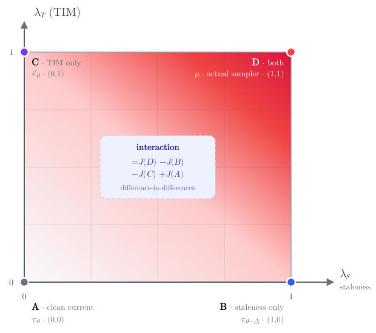
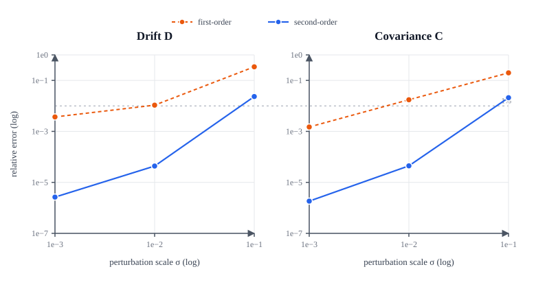
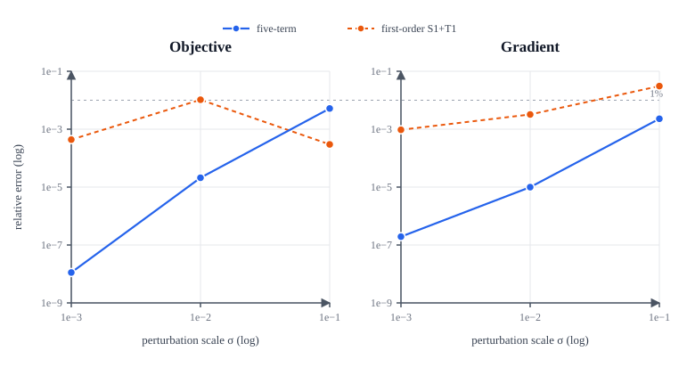

LLM RL 的稳定性，很大程度上取决于 sampler 和 trainer 有多像。理想情况下它们是同一个策略；现实中，一个在 vLLM 里生成，一个在 Megatron 里训练，中间隔着参数 lag、精度、kernel、量化、MoE routing。我们把这两类差异分别叫作 **staleness** 和 **TIM**。它们经常被混在一起讨论，但其实是两个不同空间里的扰动。

> Staleness 是参数空间的扰动，TIM 是 logit 空间的扰动；联合起来，它们仍然是一个 logit 扰动。这个观察让"两类 Mismatch"变成一个可分离的分解问题。

既然它们可以写成同一个 logit 扰动，就可以从三个坐标来分析它：

- **source**：staleness（S）还是 TIM（T）？
- **mechanism**：drift（均值平移）还是 covariance（与 reward 的耦合）？
- **resolution**：一阶、二阶，还是精确？

后面的章节就是按这三个坐标展开的：§4 是一阶的单源切片，§5 是精确的联合分解（纯 staleness + 纯 TIM + interaction），§6 是二阶的五项切片，§7 把现有方法投影到这些项上。单源分析建立坐标轴，精确联合提供 ground truth，二阶展开给出可操作的 budget。


## 主要结论

- **两类 Mismatch 可以写成同一个 logit 扰动**：staleness 分量 $\delta z_S$ 加 TIM 分量 $\delta z_T$；联合扰动就是两者之和。
- **Staleness和TIM的联合作用可以写成精确的 2D 分解**：objective 和 gradient 的 bias 都可以写成"纯 staleness + 纯 TIM + interaction"，interaction 是协方差场在 $(\lambda_S,\lambda_T)$ 正方形上的积分。
- **二阶展开有五项**：两个一阶项、两个二阶自项、一个交叉项 $ST$；一阶可加，$ST$ 是第一个不可加项。
- **SC 只消 drift**，不消 covariance；**IS 系是唯一直接压 covariance 的**；**source-reduction 是唯一能区分两源的**。
- **一句话**：现有方法的分工是"SC 管 drift，IS/mask 管 covariance，FP16/router replay 管源"；$ST$ 和二阶 covariance 仍缺少显式处理。

文中的 **推导** 折叠块是补充证明，第一遍阅读可以跳过；正文的公式和结论不依赖它们。


## 1. 两个引擎，两类 Mismatch

LLM RL 通常把 rollout 和训练拆成两个引擎：rollout engine（vLLM、SGLang 等）生成轨迹，trainer（Megatron、FSDP 等）计算梯度。理想情况下两者是同一个策略：

$$
\pi_{\text{sampler}}=\pi_{\text{trainer}}.
$$

现实中它们至少会在两个地方不同：

- **Staleness / off-policyness**：sampler 用的是旧参数 $\theta_{t-a}$，trainer 用的是当前参数 $\theta_t$。这是**参数空间**的失配（即 Mismatch）。
- **Training-inference mismatch (TIM)**：sampler 与 trainer 参数相同，但 kernel、精度、量化、reduction order、MoE routing 不同。这是**同参数下 logit 空间**的失配。

记当前参数为 $\theta$，sampler 的旧参数为 $\theta'$，参数 lag 为 $\Delta=\theta-\theta'$；$\mu$ 是 sampler 分布，$z_\theta$ 是 logit；$\eta$ 是 learning rate，$a$ 是 policy age。

| | Staleness / off-policyness | TIM |
|---|---|---|
| 扰动空间 | 参数空间 $\Delta=\theta-\theta'$ | logit 空间 $\delta z_T$ |
| 数学形式 | $\mu=\pi_{\theta-\Delta}$ | $\mu=\mathrm{softmax}(z_\theta+\delta z_T)$ |
| 典型来源 | async 训练 [1,2]、replay、长 trajectory | FP16/BF16 [7]、量化 [1]、kernel、MoE routing [9] |
| 随 age 的行为 | $\delta z_S=O(\eta a)$，随 age 增长 | $\delta z_T=O(1)$，与 age 无关 |
| 典型症状 | drift 随 age 累积、梯度范数增长 | 系统性偏差、quantization 下崩溃 |

关键观察：**两者都可以写成 logit 扰动，而且在 logit 空间是相加的**。这是本文后面所有分解的起点。SC Paper [1] 从 drift 的角度分析 TIM，Mang&Wang's Blog [2] 从 age 的角度分析 async staleness；本文把两者放进同一个分解。


## 2. Minimal Background: Drift and Signal

### 2.1 Policy Gradient

对 prompt $x$，策略 $\pi_\theta(y\mid x)$ 生成 response $y$，reward 为 $R(x,y)$。Objective 与 gradient 是

$$
J(\theta)=\mathbb{E}_{\pi_\theta}[R],
\qquad
g(\theta)=\nabla J(\theta)=\mathbb{E}_{\pi_\theta}[R\,s_\theta], \qquad (1)
$$

其中 $s_\theta=\nabla_\theta\log\pi_\theta$ 是 score。score 在自身策略下期望为零：

$$
\mathbb{E}_{\pi_\theta}[s_\theta\mid x]
=\int \pi_\theta(y\mid x)\,\nabla_\theta\log\pi_\theta(y\mid x)\,dy
=\nabla_\theta\!\int \pi_\theta(y\mid x)\,dy
=\nabla_\theta 1=0,
$$

所以协方差 $\mathrm{Cov}(R,s_\theta)=\mathbb{E}[Rs_\theta]-\mathbb{E}[R]\,\mathbb{E}[s_\theta]$ 的第二项消失，on-policy 时梯度就是 reward 与 score 的 covariance。直观上，只有 reward 随采样 token 变化的部分才产生梯度：常数 reward、或只依赖 $x$ 的 baseline，都不改变梯度。

如果数据来自 sampler $\mu$ 而不是 $\pi_\theta$，实际估计的是

$$
\hat g(\theta;\mu)=\mathbb{E}_\mu[R\,s_\theta]. \qquad (2)
$$

它一般不等于 $g(\theta)$。差多少、差在哪，就是这篇文章要回答的问题。

下面的推导固定一个 prefix，把 $R$ 看作下一个 token 的函数，即 per-token 视角；sequence 级只需对位置求和（cross-token 的 compounding 见 §9）。

### 2.2 Drift 与 Signal

在 $\mu$ 下做一次 covariance 分解 [1]：

$$
\mathbb{E}_\mu[R\,s_\theta]
=\underbrace{\mathbb{E}_\mu[R]\,\mathbb{E}_\mu[s_\theta]}_{\text{drift }D}
+\underbrace{\mathrm{Cov}_\mu(R,s_\theta)}_{\text{signal}}. \qquad (3)
$$

- **Drift** 只通过 reward 均值依赖 $R$，不含"哪个 token 导致成功"的信息。它是朝 sampler 的蒸馏项{{note: 把 $\mathbb{E}_\mu[s_\theta]$ 看作分布距离的梯度：$\mathbb{E}_\mu[s_\theta]=\nabla_\theta\mathbb{E}_\mu[\log\pi_\theta]=-\nabla_\theta\mathrm{KL}(\mu\|\pi_\theta)$。因此 $\bar R>0$ 时，drift 在降低 sampler 与 trainer 的 KL，把 $\pi_\theta$ 拉向 $\mu$，与蒸馏/SFT 的更新同形；它只由平均 reward 加权，不含 token 级 credit。on-policy 时 $\mu=\pi_\theta$，KL 在自身处梯度为零，drift 消失。}}；on-policy 时 $\mathbb{E}_{\pi}[s]=0$，drift 消失。
- **Signal** 是真正的学习信号，但 covariance 是在 $\mu$ 下取的，不是 $\pi$ 下。

Score Centering 的核心洞察 [1] 是：TIM 下 RL 不稳的主因不是"噪声"，而是 drift。关键是 behavior policy $\mu$ 是否固定：$\mu$ 固定时（固定 behavior policy 的 off-policy RL；SFT 是 $R\equiv1$、covariance 为零的特例），drift 是固定 KL 势 $-\bar R\nabla_\theta\mathrm{KL}(\mu\|\pi_\theta)$ 的梯度，有不动点，不会自我放大；TIM/async 下 $\mu$ 是 trainer 的滞后、带偏副本，KL 目标随 trainer 移动，drift 才变成反馈回路。同步 on-policy 时 $\mu=\pi_\theta$，drift 恰为零。

Drift 像是一个看不见的 teacher，一直在把 student 拉向 sampler。

### 2.3 Score Centering 与 Importance Sampling

**Score centering (SC) [1]** 减去 sampler 下的期望 score：

$$
\tilde s=s_\theta-\mathbb{E}_\mu[s_\theta].
$$

于是

$$
\mathbb{E}_\mu[R\,\tilde s]
=\underbrace{\mathbb{E}_\mu[R]\,\mathbb{E}_\mu[\tilde s]}_{=0}
+\mathrm{Cov}_\mu(R,\tilde s)
=\mathrm{Cov}_\mu(R,s_\theta). \qquad (4)
$$

Drift 被精确消掉；剩下的是 covariance。

**Importance sampling (IS)** 则用 ratio $w=\pi_\theta/\mu$ 重加权：

$$
\mathbb{E}_\mu[w\,R\,s_\theta]=\mathbb{E}_{\pi_\theta}[R\,s_\theta].
$$

Exact IS 无偏，但方差高；实践中常用 truncated IS (TIS) [3] 或 masked IS (MIS) [4]。

### 2.4 现有方法的两个经验事实

- SC Paper [1]：quantization 下 SC 单独可以匹配或超过 IS；严重 staleness 下 SC+TIS/MIS 最好。
- Mang&Wang's Blog [2]：drift norm 随 age 增长；SC 把 age-64/age-0 的 grad-norm ratio 从 3.24 降到 1.54；state-level KL mask 和 KL penalty 可以进一步稳定。

这些现象背后，其实是不同的项在被消除。下面先把记号固定下来，再把它们放进同一个表达式。


## 3. Notations

> 本文统一用 $\pi$ 表示 trainer、$\mu$ 表示 sampler（SC Paper 用 $p/q$，Mang&Wang's Blog 用 $\pi/\mu$，引用时按此映射）。未写下标的 $\mathbb{E},\mathrm{Cov}$ 默认在 $\pi=\pi_\theta$ 下；$\mathbb{R}$、$\mathrm{softmax}$、$\log$、$\sum$、$\int$ 按通常含义使用，$d$ 为微分。

<details>
<summary><b>符号表</b>：点击展开</summary>

| 符号 | 含义 |
|---|---|
| $x$ | prompt / state（prefix） |
| $v\in\mathcal{V}$ | 词表 $\mathcal{V}$ 中的一个 token；$V=\lvert\mathcal{V}\rvert$ 为词表大小 |
| $y$ | response（token 序列） |
| $\theta\in\mathbb{R}^P$ | trainer 参数；$P$ 为参数维度 |
| $\theta'=\theta-\Delta$ | stale sampler 参数；$\Delta$ 为参数 lag |
| $a$ | policy age；$\Delta=O(\eta a)$ |
| $\eta$ | learning rate |
| $t$ | 时间步 / 参数步 |
| $z_\theta(v\mid x)$ | logit；$z$ 为简写 |
| $\pi_\theta(v\mid x)$ | trainer policy $=\mathrm{softmax}(z_\theta)_v$；$\pi$ 为简写 |
| $\mu$ | sampler 分布 |
| $\tilde\pi_\theta$ | TIM 扰动后的 policy $=\mathrm{softmax}(z+\delta z_T)$ |
| $\mathrm{A},\mathrm{B},\mathrm{C},\mathrm{D}$ | 2x2 factorial 的四个端点（§5.1）；正体，与斜体的 drift $D$、covariance $C$ 区分 |
| $\delta z_S$ | staleness 造成的 logit 差 $=z_{\theta-\Delta}-z_\theta$ |
| $\delta z_T$ | TIM 造成的 logit 差 |
| $\delta z$ | 总 logit 扰动 $=\delta z_S+\delta z_T$ |
| $s_\theta(v\mid x)$ | score $=\nabla_\theta\log\pi_\theta$；$s$ 为简写 |
| $R(x,y)$ | reward；per-token 分析中固定 prefix 后视为下一个 token $v$ 的函数；也用于 advantage（见 §6.4） |
| $A$ | advantage $=R-\beta(x)$（§6.4） |
| $\bar A$ | prefix-level 平均 advantage（§6.4） |
| $\beta(x)$ | state-dependent baseline（§6.4） |
| $\bar R$ | $\mathbb{E}_{\pi_\theta}[R]$ |
| $J$ | objective；$J(\theta)=\mathbb{E}_{\pi_\theta}[R]$，插值版本 $J(\lambda_S,\lambda_T)=\mathbb{E}_{\pi_{\lambda_S,\lambda_T}}[R]$（§5.2） |
| $\Delta J,\Delta J_S,\Delta J_T$ | objective 变化及其纯 staleness / 纯 TIM 分量（§5.2） |
| $g(\theta)$ | true gradient $\nabla J(\theta)$ |
| $G(\lambda_S,\lambda_T)$ | 插值 policy 下的 gradient estimator $=\mathbb{E}_{\pi_{\lambda_S,\lambda_T}}[Rs_\theta]$（§5.2） |
| $b$ | gradient bias $=\mathbb{E}_\mu[Rs_\theta]-\mathbb{E}_\pi[Rs_\theta]$ |
| $b_S,b_T,b_{\mathrm{int}}$ | staleness / TIM / interaction 的 gradient bias 分量；§4 中是一阶截断，§5 中是精确分量 |
| $b^{(1)}$ | 一阶总 gradient bias（§4.3） |
| $D$ | drift $=\mathbb{E}_\mu[R]\mathbb{E}_\mu[s_\theta]$（斜体） |
| $C$ | covariance bias $=b-D$（斜体） |
| $D^{(1)},C^{(1)}$ | 总一阶 drift / covariance bias |
| $H$ | $\mathbb{E}_\pi[Rss^\top]$ |
| $F$ | $\mathbb{E}_\pi[ss^\top]$（Fisher information） |
| $a_S,a_T$ | centered logit 扰动 $\delta z_S-\mathbb{E}_\pi[\delta z_S]$、$\delta z_T-\mathbb{E}_\pi[\delta z_T]$；§5 的积分中随路径变化，§6 的展开中是展开点的值 |
| $u$ | 总 centered logit 扰动 $=a_S+a_T$（§6） |
| $\lambda_S,\lambda_T\in[0,1]$ | 2D 插值路径参数 |
| $\pi_{\lambda_S,\lambda_T}$ | 插值 policy $=\mathrm{softmax}(z+\lambda_S\delta z_S+\lambda_T\delta z_T)$ |
| $S_1,T_1,S_2,T_2,ST$ | §6 的五项标签（不是随机变量） |
| $\mathrm{Int}_J$ | objective 的 interaction 项 |
| $D_S^{(1)},C_S^{(1)},D_T^{(1)},C_T^{(1)}$ | 一阶 drift / covariance 分量 |
| $d_{\mathrm{KL}}(x)$ | state-level KL，即 $D_{\mathrm{KL}}(\mu(\cdot\mid x)\|\pi(\cdot\mid x))$ |
| $\tau$ | state-KL mask 阈值 |
| $\nu$ | effective sampling distribution $\propto\mu w$ |
| $w$ | importance weight |
| $W$ | 附录 A 的随机矩阵（$z=W\theta$） |
| $\mathbb{E},\mathrm{Cov}$ | 期望 / 协方差 |
| $O(\cdot)$ | 大 O |
| $\top$, $\|\cdot\|$ | 转置 / L2 范数 |

</details>

## 4. Staleness和TIM的单源作用：一阶偏差

先统一记号。给定 sampler $\mu$，gradient bias 定义为

$$
b=\mathbb{E}_\mu[Rs_\theta]-\mathbb{E}_\pi[Rs_\theta].
$$

§4 分别考虑两个单源情形：纯 staleness（$\mu=\pi_{\theta-\Delta}$）的偏差记 $b_S$，纯 TIM（sampler 的 logit 带误差 $\delta z_T$）的偏差记 $b_T$；以下都只保留各自的一阶项。

### 4.1 纯 Staleness

Sampler 用 $\theta-\Delta$，trainer 用 $\theta$。记

$$
\delta z_S=z_{\theta-\Delta}-z_\theta
\approx-\Delta^\top\nabla_\theta z.
$$

对 [1] 的 covariance 分解做参数空间一阶展开，得到一阶梯度偏差：

$$
b_S=\mathrm{Cov}_\pi(Rs,\delta z_S)
=-\underbrace{\mathbb{E}_\pi[Rss^\top]}_{H}\Delta
=-H\Delta. \qquad (5)
$$

这里用到两步：由 $\delta z_S\approx-\Delta^\top\nabla_\theta z$ 和 score 恒等式 $\nabla_\theta z=s_\theta+\mathbb{E}_{\pi_\theta}[\nabla_\theta z]$，第二项在固定 prefix 下与采样 token 无关，在 covariance 中抵消；再用 $\mathbb{E}_\pi[s_\theta]=0$，有 $\mathrm{Cov}_\pi(Rs,s_\theta)=\mathbb{E}_\pi[Rss_\theta^\top]$。

<details>
<summary><b>推导</b>：一阶偏差的来历</summary>

先看 $b_S$ 为什么等于 covariance。纯 staleness 下 $\mu=\pi_{\theta-\Delta}=\mathrm{softmax}(z+\delta z_S)$。先展开分子和分母（指数函数的 Taylor 展开 $e^x=1+x+O(x^2)$）：

$$
e^{\delta z_S}=1+\delta z_S+O(\delta z_S^2),
\qquad
\mathbb{E}_{\pi}[e^{\delta z_S}]
=1+\mathbb{E}_{\pi}[\delta z_S]+O(\delta z_S^2).
$$

再用 $(1+x)^{-1}=1-x+O(x^2)$ 和乘法展开：

$$
\begin{aligned}
\frac{\mu}{\pi}
&=\frac{e^{\delta z_S}}{\mathbb{E}_{\pi}[e^{\delta z_S}]}\\
&=\frac{1+\delta z_S+O(\delta z_S^2)}
        {1+\mathbb{E}_{\pi}[\delta z_S]+O(\delta z_S^2)}\\
&=(1+\delta z_S)(1-\mathbb{E}_{\pi}[\delta z_S])+O(\delta z_S^2)\\
&=1+\delta z_S-\mathbb{E}_{\pi}[\delta z_S]+O(\delta z_S^2),
\end{aligned}
$$

最后一步丢掉二阶交叉项 $\delta z_S\,\mathbb{E}_{\pi}[\delta z_S]$。

于是

$$
b_S
=\mathbb{E}_{\pi}\Big[\Big(\frac{\mu}{\pi}-1\Big)Rs_\theta\Big]+O(\Delta^2)
=\mathbb{E}_{\pi}\big[Rs_\theta(\delta z_S-\mathbb{E}_{\pi}[\delta z_S])\big]+O(\Delta^2)
=\mathrm{Cov}_{\pi}(Rs_\theta,\delta z_S)+O(\Delta^2).
$$

下面用导数形式重写同一件事。对 $p_\epsilon=\mathrm{softmax}(z+\epsilon\,\delta z)$，有

$$
\partial_\epsilon\log p_\epsilon=\delta z-\mathbb{E}_{p_\epsilon}[\delta z].
$$

于是对任意统计量 $f$，

$$
\partial_\epsilon\mathbb{E}_{p_\epsilon}[f]
=\mathbb{E}_{p_\epsilon}\big[f\,(\delta z-\mathbb{E}_{p_\epsilon}[\delta z])\big].
$$

取 $f=Rs_\theta$，在 $\epsilon=0$ 处取一阶项，得到 $b_S=\mathrm{Cov}_\pi(Rs_\theta,\delta z_S)+O(\Delta^2)$。对 $\Delta$ 做一阶展开，$\delta z_S\approx-\Delta^\top\nabla_\theta z$；又因为

$$
s_\theta=\nabla_\theta\log\pi_\theta
=\nabla_\theta z-\mathbb{E}_{\pi_\theta}[\nabla_\theta z],
$$

即 score 是中心化的 logit 梯度。记 $c(x)=\mathbb{E}_{\pi_\theta}[\nabla_\theta z]$，它在固定 prefix 下与采样 token 无关，所以 $\mathrm{Cov}_\pi(Rs_\theta,c(x))=0$。这里 $\mathrm{Cov}_\pi(Rs_\theta,\nabla_\theta z)$ 是 $P\times P$ 的交叉协方差矩阵，于是

$$
\begin{aligned}
b_S
&=\mathrm{Cov}_\pi(Rs_\theta,\delta z_S)\\
&=\mathrm{Cov}_\pi\big(Rs_\theta,-\Delta^\top\nabla_\theta z\big)\\
&=-\mathrm{Cov}_\pi(Rs_\theta,\nabla_\theta z)\,\Delta\\
&=-\mathrm{Cov}_\pi(Rs_\theta,s_\theta)\,\Delta\\
&=-\mathbb{E}_\pi[Rs_\theta s_\theta^\top]\Delta
=-H\Delta.
\end{aligned}
$$

下面把 $H$ 拆开，就得到 (6)。

</details>

把 $H$ 拆成均值部分和 covariance 部分：

$$
H=\bar R\,F+\mathrm{Cov}_\pi(R,ss^\top).
$$

<details>
<summary><b>推导</b>：H 的拆分</summary>

把 $R=\bar R+(R-\bar R)$ 代入：

$$
\begin{aligned}
H
&=\mathbb{E}_\pi[Rss^\top]\\
&=\bar R\,\mathbb{E}_\pi[ss^\top]+\mathbb{E}_\pi[(R-\bar R)ss^\top]\\
&=\bar R\,F+\mathrm{Cov}_\pi(R,ss^\top),
\end{aligned}
$$

其中 $F=\mathbb{E}_\pi[ss^\top]$，$\mathrm{Cov}_\pi(R,ss^\top)=\mathbb{E}_\pi[(R-\bar R)ss^\top]$。

</details>

于是

$$
b_S=D_S^{(1)}+C_S^{(1)},
\qquad
D_S^{(1)}=-\bar R\,F\Delta,
\qquad
C_S^{(1)}=-\mathrm{Cov}_\pi(R,ss^\top)\Delta. \qquad (6)
$$

直观上，drift 是「平均 reward × Fisher × 参数 lag」，covariance 是「reward 的波动 × lag」。

### 4.2 纯 TIM

Sampler 用同一参数，但 logit 有误差 $\delta z_T$。把 [1] 的分解用到这个纯 logit 扰动上，一阶项是：

$$
b_T=\mathrm{Cov}_\pi(Rs,\delta z_T), \qquad (7)
$$

$$
D_T^{(1)}=\bar R\,\mathrm{Cov}_\pi(s,\delta z_T),
\qquad
C_T^{(1)}=\mathrm{Cov}_\pi\big((R-\bar R)s,\delta z_T\big). \qquad (8)
$$

关键判据：**一阶上，TIM 的危害不取决于 $\|\delta z_T\|$ 的大小，而取决于 $\delta z_T$ 与 $Rs$ 的相关性**。如果数值误差与学习信号独立，误差再大也基本无害；如果它系统性偏向高 reward token，误差再小也可能致命。这解释了为什么系统性的 quantization 比无偏的随机噪声更危险 [1,7]。

<details>
<summary><b>推导</b>：TIM 偏差的 drift / covariance 拆分</summary>

记 $a_T=\delta z_T-\mathbb{E}_\pi[\delta z_T]$。沿用 §4.1 的一阶公式，

$$
b_T=\mathbb{E}_\pi[Rs_\theta a_T].
$$

把 $R=\bar R+(R-\bar R)$ 拆开：

$$
b_T=\bar R\,\mathbb{E}_\pi[s_\theta a_T]
+\mathbb{E}_\pi[(R-\bar R)s_\theta a_T].
$$

第一项只通过 $\bar R$ 依赖 reward，是 drift；第二项是 reward 的波动与 score 的协方差，是 covariance。因为 $\mathbb{E}_\pi[a_T]=0$，

$$
\mathbb{E}_\pi[s_\theta a_T]=\mathrm{Cov}_\pi(s_\theta,\delta z_T),
\qquad
\mathbb{E}_\pi[(R-\bar R)s_\theta a_T]
=\mathrm{Cov}_\pi\big((R-\bar R)s_\theta,\delta z_T\big).
$$

这就是 (8)。

</details>

### 4.3 一阶可加

把两源的一阶项相加：

$$
b^{(1)}=-H\Delta+\mathrm{Cov}_\pi(Rs,\delta z_T), \qquad (9)
$$

$$
D^{(1)}=-\bar R F\Delta+\bar R\,\mathrm{Cov}_\pi(s,\delta z_T),
$$

$$
C^{(1)}=-\mathrm{Cov}_\pi(R,ss^\top)\Delta
+\mathrm{Cov}_\pi\big((R-\bar R)s,\delta z_T\big).
$$

一阶上，staleness 与 TIM 是可加的，没有交叉项。问题从二阶开始。


## 5. Staleness和TIM的联合作用：一个精确的 2D 分解

### 5.1 设定

实际 sampler 同时有参数 lag 和 TIM：

$$
\mu=\mathrm{softmax}\big(z_{\theta-\Delta}+\delta z_T\big).
$$

记

$$
\delta z_S:=z_{\theta-\Delta}-z_\theta,
\qquad
\delta z:=\delta z_S+\delta z_T. \qquad (10)
$$

注意这里的 $\delta z_S$ 是**精确的 logit 差**；§4 的一阶分析用的是它的线性化 $-\Delta^\top\nabla_\theta z$。两源在 logit 空间相加，非线性全部来自 softmax 和期望。

对 $\lambda_S,\lambda_T\in[0,1]$ 定义插值 policy：

$$
\pi_{\lambda_S,\lambda_T}:=\mathrm{softmax}\big(z+\lambda_S\delta z_S+\lambda_T\delta z_T\big).
$$

端点可以用一张 2x2 表表示：

| | TIM = 0 | TIM = $\delta z_T$ |
|---|---|---|
| staleness = 0 | $\mathrm{A}=\pi_\theta$ | $\mathrm{C}=\tilde\pi_\theta$ |
| staleness = $\Delta$ | $\mathrm{B}=\pi_{\theta-\Delta}$ | $\mathrm{D}=\mu$ |

**表 1**：2x2 factorial 的四个端点。A 没有失配，B 只有 staleness，C 只有 TIM，D 两者都有（实际 sampler）。

记插值策略的 objective 为

$$
J(\lambda_S,\lambda_T)=\mathbb{E}_{\pi_{\lambda_S,\lambda_T}}[R],
$$

四个端点的值简写为 $J(\mathrm{A})=J(0,0)$、$J(\mathrm{B})=J(1,0)$、$J(\mathrm{C})=J(0,1)$、$J(\mathrm{D})=J(1,1)$。定义

$$
\Delta J_S=J(\mathrm{B})-J(\mathrm{A}),\qquad
\Delta J_T=J(\mathrm{C})-J(\mathrm{A}),\qquad
\mathrm{Int}_J=J(\mathrm{D})-J(\mathrm{B})-J(\mathrm{C})+J(\mathrm{A}).
$$

$\mathrm{Int}_J$ 就是 **interaction**：两个失配源同时存在时，objective 相对"两个单源效应之和"多出的部分，即四个角的 difference-in-differences。

这里的 **2D** 指的是两个插值参数 $(\lambda_S,\lambda_T)\in[0,1]^2$：$\lambda_S$ 控制 staleness 的强度，$\lambda_T$ 控制 TIM 的强度。把两个失配源看成平面上的两个坐标轴，四个端点就是 A/B/C/D；interaction 也可以写成混合偏导 $\partial_{\lambda_S}\partial_{\lambda_T}J$ 在这个单位正方形上的积分。



**图 1**：$(\lambda_S,\lambda_T)$ 平面。横轴是 staleness 强度 $\lambda_S$，纵轴是 TIM 强度 $\lambda_T$；A 是原点，B 是纯 staleness，C 是纯 TIM，D 是两者叠加。$\mathrm{Int}_J=J(\mathrm{D})-J(\mathrm{B})-J(\mathrm{C})+J(\mathrm{A})$ 是四个角的 difference-in-differences。

> **Side note.** 这里的路径是 logit 空间的线性插值。四个端点固定，所以上面定义的 $\Delta J_S,\Delta J_T,\mathrm{Int}_J$ 都只由端点决定，与插值路径无关。路径只改变被积函数（协方差场）在正方形内的分布，不改变三个积分的值。

### 5.2 精确分解

在 [1] 的 drift/covariance 分解基础上，对上面定义的 $J(\lambda_S,\lambda_T)$ 求导。先重述 centered 扰动：在插值点 $\pi_{\lambda_S,\lambda_T}$ 下，

$$
a_S=\delta z_S-\mathbb{E}_{\pi_{\lambda_S,\lambda_T}}[\delta z_S],
\qquad
a_T=\delta z_T-\mathbb{E}_{\pi_{\lambda_S,\lambda_T}}[\delta z_T].
$$

于是

$$
\partial_{\lambda_S}J=\mathbb{E}[R a_S],
\qquad
\partial_{\lambda_T}J=\mathbb{E}[R a_T],
$$

$$
\partial_{\lambda_S}\partial_{\lambda_T}J
=\mathrm{Cov}(R,a_S a_T).
$$

这里的 $\mathbb{E}$ 和 $\mathrm{Cov}$ 都在 $\pi_{\lambda_S,\lambda_T}$ 下；为简洁省略下标。

<details>
<summary><b>推导</b>：2D 分解与混合偏导</summary>

对 $\pi_\lambda=\mathrm{softmax}(z+\lambda_S\delta z_S+\lambda_T\delta z_T)$，

$$
\partial_{\lambda_S}\log\pi_\lambda=\delta z_S-\mathbb{E}_{\pi_\lambda}[\delta z_S]=a_S,
$$

所以对任意 $f$，

$$
\partial_{\lambda_S}\mathbb{E}_{\pi_\lambda}[f]=\mathbb{E}_{\pi_\lambda}[f a_S].
$$

再对 $\lambda_T$ 求一次导：

$$
\partial_{\lambda_T}\mathbb{E}_{\pi_\lambda}[f a_S]
=\mathbb{E}_{\pi_\lambda}[f a_S a_T]
+\mathbb{E}_{\pi_\lambda}[f\,\partial_{\lambda_T}a_S].
$$

由 $a_S=\delta z_S-\mathbb{E}_{\pi_\lambda}[\delta z_S]$ 得 $\partial_{\lambda_T}a_S=-\mathbb{E}_{\pi_\lambda}[a_S a_T]$，所以

$$
\partial_{\lambda_S}\partial_{\lambda_T}\mathbb{E}_{\pi_\lambda}[f]
=\mathbb{E}[f a_S a_T]-\mathbb{E}[f]\,\mathbb{E}[a_S a_T]
=\mathrm{Cov}_{\pi_\lambda}(f,a_S a_T).
$$

取 $f=R$ 得到 objective 的混合偏导；取 $f=Rs_\theta$（$s_\theta$ 固定为 trainer score）得到 gradient 的混合偏导。

最后对正方形用二维 Newton–Leibniz 公式：

$$
J(1,1)-J(0,0)
=\big[J(1,0)-J(0,0)\big]
+\big[J(0,1)-J(0,0)\big]
+\int_0^1\!\!\int_0^1\partial_{\lambda_S}\partial_{\lambda_T}J\,d\lambda_S\,d\lambda_T.
$$

这就是 (11)；把 $J$ 换成 $G$ 就是 (12)。右边三个量都只由四角决定，与 §5.1 的 side note 一致。

</details>

因此**精确地**

$$
\Delta J:=\mathbb{E}_\mu[R]-\mathbb{E}_\pi[R]
=\underbrace{\Delta J_S}_{\text{staleness}}
+\underbrace{\Delta J_T}_{\text{TIM}}
+\underbrace{\mathrm{Int}_J}_{\text{interaction}}, \qquad (11)
$$

其中

$$
\Delta J_S=\int_0^1\mathbb{E}_{\pi_{\lambda_S,0}}[R a_S]\,d\lambda_S,
$$

$$
\Delta J_T=\int_0^1\mathbb{E}_{\pi_{0,\lambda_T}}[R a_T]\,d\lambda_T,
$$

$$
\mathrm{Int}_J=\int_0^1\int_0^1
\mathrm{Cov}_{\pi_{\lambda_S,\lambda_T}}(R,a_S a_T)\,
d\lambda_S\,d\lambda_T.
$$

对 gradient estimator $G(\lambda_S,\lambda_T)=\mathbb{E}_{\pi_{\lambda_S,\lambda_T}}[Rs_\theta]$（$s_\theta$ 固定为 trainer score）：

$$
b:=\mathbb{E}_\mu[Rs_\theta]-\mathbb{E}_\pi[Rs_\theta]
=b_S+b_T+b_{\mathrm{int}}, \qquad (12)
$$

$$
b_S=\int_0^1\mathbb{E}_{\pi_{\lambda_S,0}}[Rs_\theta a_S]\,d\lambda_S,
\qquad
b_T=\int_0^1\mathbb{E}_{\pi_{0,\lambda_T}}[Rs_\theta a_T]\,d\lambda_T,
$$

$$
b_{\mathrm{int}}=\int_0^1\int_0^1
\mathrm{Cov}_{\pi_{\lambda_S,\lambda_T}}(Rs_\theta,a_S a_T)\,
d\lambda_S\,d\lambda_T.
$$

这里的 $b_S,b_T,b_{\mathrm{int}}$ 是精确分量；§4 的 $b_S,b_T$ 是它们的一阶截断（分别为 $O(\Delta)$、$O(\delta z_T)$）。

上式对任意 $\Delta,\delta z_T$ 都**精确**，不是 Taylor 近似；它适合作为 severe quantization 下的基准，也说明 interaction 的结构：**它是 $R$（或 $Rs_\theta$）与 $a_Sa_T$ 在 $(\lambda_S,\lambda_T)$ 正方形上的协方差积分**。


## 6. 联合误差的二阶近似

### 6.1 五项

在 $\lambda_S=\lambda_T=0$ 处展开，令 $u=a_S+a_T$（$u$ 是总 centered 扰动，区别于 policy age $a$）。Gradient bias 可以写成

$$
b=\underbrace{S_1+T_1}_{\text{first order}}
+\underbrace{S_2+T_2+ST}_{\text{second order}}
+O(\delta z^3), \qquad (13)
$$

其中：

| 项 | 表达式 | 量级 | 含义 |
|---|---|---|---|
| $S_1$ | $\mathbb{E}_\pi[Rs_\theta a_S]$ | $O(\Delta)$ | staleness 一阶 |
| $T_1$ | $\mathbb{E}_\pi[Rs_\theta a_T]$ | $O(\delta z_T)$ | TIM 一阶 |
| $S_2$ | $\frac12\mathbb{E}_\pi[Rs_\theta(a_S^2-\mathbb{E}a_S^2)]$ | $O(\Delta^2)$ | staleness 二阶 |
| $T_2$ | $\frac12\mathbb{E}_\pi[Rs_\theta(a_T^2-\mathbb{E}a_T^2)]$ | $O(\delta z_T^2)$ | TIM 二阶 |
| $ST$ | $\mathbb{E}_\pi[Rs_\theta(a_Sa_T-\mathbb{E}[a_Sa_T])]$ | $O(\Delta\delta z_T)$ | 交叉项 |

**表 2**：五项展开。$S_1,T_1$ 是一阶；$S_2,T_2,ST$ 是二阶。$ST$ 是 §5 的 $\mathrm{Int}_J$ 的二阶截断；$\mathrm{Int}_J$ 还包含更高阶的交叉项。

Objective 的展开完全相同，只把 $Rs_\theta$ 换成 $R$：

$$
\Delta J=S_1+T_1+S_2+T_2+ST+O(\delta z^3).
$$

<details>
<summary><b>推导</b>：五项展开</summary>

仍用 $p_\epsilon=\mathrm{softmax}(z+\epsilon\,\delta z)$，并记 $u=\delta z-\mathbb{E}_\pi[\delta z]=a_S+a_T$。对 $\mathbb{E}_{p_\epsilon}[f]$ 在 $\epsilon=0$ 处做二阶 Taylor：

$$
\mathbb{E}_{p_1}[f]-\mathbb{E}_\pi[f]
=\mathbb{E}_\pi[f u]
+\frac12\mathbb{E}_\pi\big[f(u^2-\mathbb{E}_\pi[u^2])\big]
+O(\delta z^3).
$$

（一阶项是上一节的 $\mathbb{E}[fu]$；二阶项来自对 $\partial_\epsilon\mathbb{E}_{p_\epsilon}[f]=\mathbb{E}_{p_\epsilon}[fu]$ 再求导，其中 $\partial_\epsilon u=-\mathbb{E}_{p_\epsilon}[u^2]$。）

把 $u=a_S+a_T$ 代入，$u^2=a_S^2+2a_Sa_T+a_T^2$，取 $f=Rs_\theta$：

$$
\mathbb{E}[Rs_\theta u]=S_1+T_1,
$$

$$
\frac12\mathbb{E}\big[Rs_\theta(u^2-\mathbb{E}u^2)\big]
=S_2+T_2+ST.
$$

交叉项的系数是 $\frac12\cdot 2=1$。取 $f=R$ 就得到 objective 的同一组五项。

</details>

### 6.2 一阶可加，为什么还需要二阶？

- $S_1+T_1$ 是一阶可加的部分。
- $S_2,T_2$ 是**纯源**的二阶修正：即使另一源为零，它们也在。
- $ST$ 是第一个把两源耦合起来的项，量级 $O(\Delta\delta z_T)$。

两个特例：

- $\delta z_T=0$：$T_1=T_2=ST=0$，只剩 $S_1+S_2$（纯 staleness 二阶）。
- $\delta z_S=0$：$S_1=S_2=ST=0$，只剩 $T_1+T_2$（纯 TIM 二阶）。

### 6.3 Drift / Covariance 拆分

对总 bias $b$，drift $D=\mathbb{E}_\mu[R]\mathbb{E}_\mu[s_\theta]$。到二阶：

$$
D=\bar R\,\mathbb{E}[s u]
+\frac12\bar R\,\mathbb{E}[s(u^2-\mathbb{E}u^2)]
+\mathbb{E}[R u]\,\mathbb{E}[s u]
+O(\delta z^3). \qquad (14)
$$

Covariance bias $C=b-D$：

$$
C=\mathbb{E}[(R-\bar R)s u]
+\frac12\mathbb{E}[(R-\bar R)s(u^2-\mathbb{E}u^2)]
-\mathbb{E}[R u]\,\mathbb{E}[s u]
+O(\delta z^3). \qquad (15)
$$

注意 $C=b-D=\mathrm{Cov}_\mu(R,s_\theta)-g$：它是 §2.2 的 signal 相对真梯度的偏差。

<details>
<summary><b>推导</b>：drift 的二阶展开</summary>

把两个因子分别在 $\pi$ 处展开到二阶：

$$
\mathbb{E}_\mu[R]
=\bar R+\mathbb{E}_\pi[Ru]
+\frac12\mathbb{E}_\pi\big[R(u^2-\mathbb{E}_\pi[u^2])\big]
+O(\delta z^3),
$$

$$
\mathbb{E}_\mu[s_\theta]
=\mathbb{E}_\pi[s_\theta u]
+\frac12\mathbb{E}_\pi\big[s_\theta(u^2-\mathbb{E}_\pi[u^2])\big]
+O(\delta z^3),
$$

这里用了 $\mathbb{E}_\pi[s_\theta]=0$。两式相乘，保留到二阶：

$$
D=\mathbb{E}_\mu[R]\,\mathbb{E}_\mu[s_\theta]
=\bar R\,\mathbb{E}[s u]
+\frac12\bar R\,\mathbb{E}[s(u^2-\mathbb{E}u^2)]
+\mathbb{E}[R u]\,\mathbb{E}[s u]
+O(\delta z^3),
$$

即 (14)。再用 $b=\mathbb{E}[Rsu]+\frac12\mathbb{E}[Rs(u^2-\mathbb{E}u^2)]+O(\delta z^3)$ 减去 $D$，得到 (15)。

</details>

只保留一阶项（由 (5)(8)）：

$$
D^{(1)}=-\bar R F\Delta+\bar R\,\mathrm{Cov}(s,\delta z_T),
$$

$$
C^{(1)}=-\mathrm{Cov}(R,ss^\top)\Delta+\mathrm{Cov}((R-\bar R)s,\delta z_T),
$$

$$
b^{(1)}=D^{(1)}+C^{(1)}
=\underbrace{-H\Delta}_{\text{drift}}+\underbrace{\mathrm{Cov}(Rs,\delta z_T)}_{\text{covariance}}. \qquad (16)
$$

### 6.4 Advantage 版本

若训练用 advantage $A=R-\beta(x)$（$\beta$ 只依赖 state），把上面的 $R$ 换成 $A$、$\bar R$ 换成 prefix-level $\bar A$ 即可。因为 $A-\bar A=R-\bar R$，covariance 项对 state-dependent baseline 不变。


## 7. 现有方法：谁消了哪项

先把记号固定下来：$b=S_1+T_1+S_2+T_2+ST+O(\delta z^3)$，一阶 $S_1=D_S^{(1)}+C_S^{(1)}$，$T_1=D_T^{(1)}+C_T^{(1)}$。表中 ✓ = 精确消除（在方法的目标 regime 内）；◐ = 部分消除（例如只在 retained mass 上）；✗ = 不消除；↑ = 加回一个受控项。

缩写：IS = importance sampling；TIS/MIS = truncated/masked IS；PPO/DAPO/GSPO = ratio-clipping 类；DPPO = TV mask；TRM = trust-region masking；SC = score centering。表中的 $\nu\propto\mu w$ 是 IS 重加权后的有效分布，retained mass 就是它覆盖的质量。

方法来源：TIS [3]、MIS/IcePop [4]、DPPO [5]、TRM [8]、FP16/router replay [7,9] 分别来自对应文献；SC 和 baseline correction 来自 [1]，state-KL mask 和 KL penalty 来自 Mang&Wang's Blog [2]；PPO/DAPO/GSPO 是标准 ratio-clipping 类（DAPO [10]、GSPO [11]）。CIS [6] 不在表中：它从 log-odds 位移的角度做 confidence-aware truncation，与这里的 $\delta z$ 分解互补，§9 会再提。这里只关心这些方法对 bias 的作用，不评价具体实现。

下面先看 $D^{(1)}/C^{(1)}$ 视角（谁消 drift、谁消 covariance），再拆到五项（具体是哪一项被消掉）。表中的 SC+TIS/MIS 指在加权 score 上做 centering，也就是 SC Paper [1] 的附录 A.2 的组合方式；它不是先 SC 再 IS，顺序问题见 §7.4。

### 7.1 D/C 视角

| 方法 | $D_S^{(1)}$ | $C_S^{(1)}$ | $D_T^{(1)}$ | $C_T^{(1)}$ | 备注 |
|---|---|---|---|---|---|
| Vanilla PG | ✗ | ✗ | ✗ | ✗ | 全留 |
| Exact IS | ✓ | ✓ | ✓ | ✓ | 无偏 |
| TIS [3] | ◐ | ◐ | ◐ | ◐ | retained mass |
| MIS/IcePop [4] | ◐ | ◐ | ◐ | ◐ | retained mass + selection |
| PPO/DAPO/GSPO [10,11] | ◐ | ◐ | ◐ | ◐ | 只做截断；不区分源 |
| DPPO [5] | ◐ | ◐ | ◐ | ◐ | TV mask |
| **SC** [1] | ✓ | ✗ | ✓ | ✗ | **消 drift，留 covariance** |
| SC+TIS/MIS [1,3,4] | ✓ | ◐ | ✓ | ◐ | 加权 score 上的 SC：drift 精确为零；covariance under $\nu$ |
| state-KL mask [2] | ◐ | ◐ | ◐ | ◐ | per-state |
| TRM [8] | ◐ | ◐ | ◐ | ◐ | per-sequence |
| Baseline correction [1] | ✓ | ✗ | ✓ | ✗ | 与 SC 对偶 |
| Explicit KL penalty [2] | ↑ | ✗ | ↑ | ✗ | 加回受控 drift |
| FP16 / router replay [7,9] | ✗ | ✗ | ◐ | ◐ | 只压 TIM 源 |
| 减少 age / fresh data [1,2] | ◐ | ◐ | ✗ | ✗ | 只压 staleness 源 |
| Exact match | ✓ | ✓ | ✓ | ✓ | 不实际 |

**表 3**：$D^{(1)}/C^{(1)}$ 视角。✓ = 消除；◐ = 部分消除；✗ = 不消除；↑ = 加回受控项。

### 7.2 五项视角

| 方法 | 机制 | $S_1$ | $T_1$ | $S_2$ | $T_2$ | $ST$ | 备注 |
|---|---|---|---|---|---|---|---|
| Vanilla PG | 无修正 | ✗ | ✗ | ✗ | ✗ | ✗ | 全留 |
| Exact IS | 全词表 ratio | ✓ | ✓ | ✓ | ✓ | ✓ | 无偏，但高方差 |
| TIS [3] | 截断 ratio | ◐ | ◐ | ◐ | ◐ | ◐ | retained mass；truncated residual |
| MIS/IcePop [4] | mask out-of-band | ◐ | ◐ | ◐ | ◐ | ◐ | 丢样本；selection bias |
| PPO/DAPO/GSPO [10,11] | clip ratio | ◐ | ◐ | ◐ | ◐ | ◐ | 只做截断；不区分源 |
| DPPO [5] | TV mask | ◐ | ◐ | ◐ | ◐ | ◐ | 按 TV 筛位置 |
| **SC** [1] | 减 $\mathbb{E}_\mu[s]$ | ◐ | ◐ | ◐ | ◐ | ◐ | **只消 drift**；covariance 全留 |
| SC+TIS/MIS [1,3,4] | 加权 score 上的 SC | ◐ | ◐ | ◐ | ◐ | ◐ | drift 精确为零；covariance under $\nu$ |
| state-KL mask [2] | $d_{\mathrm{KL}}(x)>\tau$ | ◐ | ◐ | ◐ | ◐ | ◐ | per-state；不区分源 |
| TRM [8] | sequence KL mask | ◐ | ◐ | ◐ | ◐ | ◐ | per-sequence |
| Baseline correction [1] | prefix-level baseline | ◐ | ◐ | ◐ | ◐ | ◐ | 只消 drift；与 SC 对偶 |
| Explicit KL penalty [2] | KL 正则 | ✗ | ✗ | ✗ | ✗ | ✗ | 不消 bias；加回受控 drift |
| FP16 / router replay [7,9] | 减少 $\delta z_T$ | ✗ | ◐ | ✗ | ◐ | ◐ | 只压 TIM 源 |
| 减少 age / fresh data [1,2] | 减少 $\Delta$ | ◐ | ✗ | ◐ | ✗ | ◐ | 只压 staleness 源 |
| Exact match | $\mu=\pi$ | ✓ | ✓ | ✓ | ✓ | ✓ | 不实际 |

**表 4**：五项视角。✓ = 精确消除；◐ = 部分消除；✗ = 不消除。

### 7.3 为什么 SC 不够？

1. **SC 不是"消 $S_1+T_1$"**。它减去 $\mathbb{E}_\mu[s]$，精确消掉 drift $D$，所以 $D_S^{(1)},D_T^{(1)}$ 没了；但 $C_S^{(1)},C_T^{(1)}$ 原样留下，二阶项里也只消 drift 部分、不消 covariance 部分。这是"SC 之后还会不稳"的结构性原因。
2. **IS 系是唯一直接压 covariance 的**。Exact IS 全消；TIS/MIS 把 residual 限制在 truncated/masked 区域，只在 retained mass 上部分修正 covariance。这解释了 SC Paper [1] 的 "severe staleness 下 SC+TIS/MIS 最好"：$C_S^{(1)}$ 随 age 增长，SC 压不住，IS 能压一部分。
3. **只有 source-reduction 能区分 $S$ 和 $T$**。FP16 [7] / router replay [9] 压 $\delta z_T$，只动 $T_1,T_2,ST$；减少 age 压 $\Delta$，只动 $S_1,S_2,ST$。它们都不处理另一源。
4. **截断/掩码类不区分源**。PPO/DAPO/DPPO/state-KL/TRM 都是把 $\delta z$ 的幅度截断或把高 mismatch 的位置去掉，所以五项都是 ◐。PPO/DAPO 的 clip 是为 policy-movement ratio 设计的，numerical mismatch 下 rare token 的 ratio 可能因微小概率差爆炸，clip 会打偏目标——这对应 SC Paper [1] 的 "PPO/DAPO 扛 staleness 但扛不住 quantization"。
5. **KL penalty 不是 bias 修正项**。它加回一个受控 drift（↑），让 $\pi$ 靠近 $\mu$，属于 trust-region anchor；不消任何五项。
6. **空白**：目前没有方法显式针对 $ST$ 或二阶 covariance；这部分只被截断/掩码/源削减顺带影响。

### 7.4 与实验的对应

- **SC Paper [1] 的 quantization**：主要制造 $\delta z_T$。SC 消 $D_T^{(1)}$，留 $C_T^{(1)}$；TIS/MIS 只压 retained mass 上的 $C_T$。Quantization 下，SC 单独或与 TIS/MIS 组合都最好；mild 时 SC 单独就够。
- **SC Paper [1] 的 staleness**：$\Delta$ 主导。SC 消 $D_S^{(1)}$，留 $C_S^{(1)}$；TIS/MIS 压 $C_S$。这解释了 "SC+TIS/MIS 在 staleness 下最好，优于 vanilla SC"。
- **Mang&Wang's Blog [2] 的 state-KL mask**：per-state bound，压高 $d_{\mathrm{KL}}(x)$ 的 per-state 贡献，但不区分源；**KL penalty** 是 trust-region anchor，不是 bias 修正。
- **Mang&Wang's Blog [2] 的 SC+IS 批评**：两步操作不可交换。SC→IS 会把 drift 加回来（centering 用的是 $\mu$ 的期望，而 IS 把测度换成 $\pi$，剩下 $-\bar R\,\mathbb{E}_\mu[s]$ 的残差）；IS→Exact IS 时 SC 不起作用；IS→TIS 时 SC 只在有效分布 $\nu$ 上生效，而 $\nu$ 是否更接近 $\pi$ 没有保证。


## 8. 这对方法设计意味着什么

### 8.1 一个 Regime Map

| regime | 主导项 | 现有方法够不够 | 建议 |
|---|---|---|---|
| 小 age、小 TIM | $S_1,T_1$ | 一阶可加，SC 或 TIS 够 | 先做 SC |
| 大 age、小 TIM | $S_1,S_2$ | SC 消 drift，留 $C_S$ | SC + IS/mask；关注 covariance |
| 小 age、severe TIM | $T_1,T_2$ | SC 消 drift，留 $C_T$ | SC + IS/mask；匹配 kernel |
| 大 age、severe TIM | 五项全在 | 没有方法针对 $ST$ | 尚无显式处理 |

**表 5**：regime map。行是不同的失配 regime，列是实际建议。

### 8.2 实用建议

- **能匹配引擎就匹配**：FP16 [7]、router replay [9]、batch-invariant kernel 是少数能干净压 $T$ 的手段。
- **SC [1] 作为默认的 drift 修正**：它便宜、加性、没有 IS 的乘性噪声；但不要指望它消 covariance。
- **IS/mask [3,4] 作为 covariance 修正**：Exact IS 全消但高方差；TIS/MIS 是 retained-mass 上的折中。
- **不要用 KL penalty [2] 当 bias 修正**：它是 trust-region anchor，作用是控制 $\pi$ 离 $\mu$ 的距离，不是用来消 bias。


## 9. 限制与开放问题

1. **一阶/二阶展开**：$\delta z$ 小时准；severe quantization [1] 下二阶项会变大。
2. **logit 扰动假设**：sampler 与 trainer 共享 $z$，只差 $\delta z$。不同 tokenizer/架构不满足；MoE routing 是离散跳变 [9]。CIS [6] 从 log-odds 位移的角度做了连续近似，与这里的 $\delta z$ 视角互补。
3. **路径归因**：三个积分量只由四角决定，与插值路径无关（见 §5.1 的 side note）；但被积的协方差场依赖路径。若关心"哪一段 $\lambda$ 贡献了 interaction"这类局部归因，需要固定路径；本文用线性 logit 插值。
4. **序列级**：本文是 per-token 分析；长序列的 cross-token 项未算。若各位置独立，逐位置相加即可；若有 compounding，需要额外处理。
5. **估计方差**：本文主要看 bias；$S_2,T_2,ST$ 的估计方差、与 IS 的方差权衡未展开。
6. **开放问题**：$ST$ 和二阶 covariance 在真实训练中的量级，仍需 0.6B/30B 实验确认。


如果这篇文章只能带走一句话：**现有方法不是在一个维度上竞争，而是在分工消除不同的项**。SC 负责 drift，IS/mask 负责 covariance，FP16/router replay 负责源；$ST$ 和二阶 covariance 仍缺少显式处理。


## 附录 A：数值核对

<details class="appendix">
<summary><b>展开附录内容</b></summary>

这一节是一个**代数自检**，不是实验评测。它只用一个小 softmax 验证 §4–§6 的分解是否和直接计算一致；它不验证这些公式在真实 LLM 上的量级。

### A.1 设置

- $V=7$（词表大小），$P=4$（参数维度）；
- 随机 $W\in\mathbb{R}^{V\times P}$、$\theta\in\mathbb{R}^P$、$R\in\mathbb{R}^V$（固定 seed）；
- $z=W\theta$，$\pi=\mathrm{softmax}(z)$，$s_v=W_v-\mathbb{E}_\pi[W]$；
- **尺度表**：$\delta z_S,\delta z_T$ 的每个分量独立取 $\mathcal{N}(0,\sigma^2)$，$\sigma=10^{-3},10^{-2},10^{-1}$；这样检验的是任意 logit 扰动，不依赖线性参数化；
- **参数空间核对**：另取 $\Delta$ 的每个分量 $\sim\mathcal{N}(0,\sigma^2)$，令 $\delta z_S=-W\Delta$（线性映射下这是精确的 staleness logit 差），$\delta z_T$ 同上。

### A.2 怎么做

1. **精确 D/C**：$D=\bar R_\mu\bar s_\mu$，$C=b-D$，其中 $\bar R_\mu=\mathbb{E}_\mu[R]$、$\bar s_\mu=\mathbb{E}_\mu[s_\theta]$、$b=\mathbb{E}_\mu[Rs_\theta]-\mathbb{E}_\pi[Rs_\theta]$。
2. **D-C（drift/covariance）一阶/二阶**：$D^{(1)}=\bar R\,\mathbb{E}_\pi[su]$、$C^{(1)}=\mathbb{E}_\pi[(R-\bar R)su]$；二阶用 (14)(15)；$u=a_S+a_T$。
3. **五项**：在展开点算 $S_1,T_1,S_2,T_2,ST$，求和。
4. **一阶总 bias**：只算 $S_1+T_1$。
5. **interaction**：用 $80\times80$ 网格在 $(\lambda_S,\lambda_T)\in[0,1]^2$ 上数值积分 $\mathrm{Cov}(R,a_Sa_T)$，和精确的 difference-in-differences $J(1,1)-J(1,0)-J(0,1)+J(0,0)$ 比较。

下面先看 D-C，再看五项。

### A.3 Drift/Covariance（D-C）视角的核对

按上面的定义，先看 D-C 的相对误差随 $\sigma$ 的变化。



**图 2**：D-C 视角的相对误差随扰动尺度 $\sigma$ 的变化（log-log）。左：drift $D$；右：covariance $C$。实线是二阶 $D^{(2)},C^{(2)}$，虚线是一阶 $D^{(1)},C^{(1)}$；灰虚线是 1% 参考线。

| $\sigma$ | err $D^{(1)}$ | err $D^{(2)}$ | err $C^{(1)}$ | err $C^{(2)}$ |
|---|---|---|---|---|
| $10^{-3}$ | $3.7\times10^{-3}$ | $2.7\times10^{-6}$ | $1.5\times10^{-3}$ | $1.8\times10^{-6}$ |
| $10^{-2}$ | $1.1\times10^{-2}$ | $4.4\times10^{-5}$ | $1.7\times10^{-2}$ | $4.5\times10^{-5}$ |
| $10^{-1}$ | $3.4\times10^{-1}$ | $2.3\times10^{-2}$ | $2.0\times10^{-1}$ | $2.1\times10^{-2}$ |

**分量与参数空间核对（$\sigma=10^{-2}$）**：

| 检查 | 相对误差 |
|---|---|
| $D^{(1)}$ vs $D_S^{(1)}+D_T^{(1)}$ | $\sim10^{-16}$ |
| $C^{(1)}$ vs $C_S^{(1)}+C_T^{(1)}$ | $\sim10^{-16}$ |
| $D_S^{(1)}$ vs $-\bar R F\Delta$ | $\sim10^{-16}$ |
| $C_S^{(1)}$ vs $-\mathrm{Cov}(R,ss^\top)\Delta$ | $\sim10^{-16}$ |
| $D_T^{(1)}$ vs $\bar R\mathrm{Cov}(s,\delta z_T)$ | $\sim10^{-16}$ |
| $C_T^{(1)}$ vs $\mathrm{Cov}((R-\bar R)s,\delta z_T)$ | $\sim10^{-16}$ |

**纯源一阶误差（$\sigma=10^{-2}$）**：

| 源 | err $D^{(1)}$ | err $C^{(1)}$ |
|---|---|---|
| staleness | $3.3\times10^{-2}$ | $7.1\times10^{-3}$ |
| TIM | $6.4\times10^{-3}$ | $3.0\times10^{-3}$ |

**读法**：

- 一阶 $D,C$ 的误差是 $O(\delta z)$ 的相对量级，二阶 $D,C$ 降到 $O(\delta z^2)$。
- 参数空间形式与 centered 扰动形式在机器精度上一致：这说明 §7.1 表里的 $-\bar R F\Delta$、$-\mathrm{Cov}(R,ss^\top)\Delta$、$\bar R\mathrm{Cov}(s,\delta z_T)$、$\mathrm{Cov}((R-\bar R)s,\delta z_T)$ 不只是口号，而是同一个对象的等价写法。
- $C_T^{(1)}$ 的协方差里要减去 $g\,\mathbb{E}[\delta z_T]$；这是 $\mathrm{Cov}((R-\bar R)s,\delta z_T)$ 的定义要求的。实现时容易漏掉，数值上会差很多；补上后回到机器精度（$\sim10^{-16}$）。
- 这条核对也解释了 §7.1 表的含义：SC 消 $D$、留 $C$，不是"消 $S_1+T_1$"；$D$ 和 $C$ 都是可数值验证的对象。

### A.4 五项视角的核对

再看总 bias 的五项展开。



**图 3**：代数自检的相对误差随扰动尺度 $\sigma$ 的变化（log-log）。左：objective；右：gradient。实线是五项展开，虚线是一阶 $S_1+T_1$；灰虚线是 1% 参考线。objective 的一阶误差在 $\sigma=10^{-1}$ 处向下折，是二阶项抵消的巧合。

| 检查 | 设置 | 相对误差 |
|---|---|---|
| objective 五项 vs 精确值 | $\sigma=10^{-3}/10^{-2}/10^{-1}$ | $1.1\times10^{-8}$ / $2.1\times10^{-5}$ / $5.2\times10^{-3}$ |
| objective 一阶 vs 精确值 | 同上 | $4.4\times10^{-4}$ / $1.0\times10^{-2}$ / $3.0\times10^{-4}$ |
| interaction 积分 vs 精确值 | $\sigma=0.05/0.2$ | $1.7\times10^{-5}$ / $4.1\times10^{-4}$ |
| gradient 五项 vs 精确值 | $\sigma=10^{-3}/10^{-2}/10^{-1}$ | $1.9\times10^{-7}$ / $1.0\times10^{-5}$ / $2.3\times10^{-3}$ |
| gradient 一阶 vs 精确值 | 同上 | $9.5\times10^{-4}$ / $3.2\times10^{-3}$ / $3.1\times10^{-2}$ |

**读法**：

- **五项展开在 $\sigma=10^{-2}$ 时很准**：objective 的相对误差约 $10^{-5}$，gradient 也约 $10^{-5}$，说明 §5–§6 的代数实现没有错。
- **到 $\sigma=10^{-1}$ 时二阶项开始明显**：objective 五项误差升到约 $5\times10^{-3}$，gradient 升到约 $2\times10^{-3}$。
- **interaction 积分和 difference-in-differences 对得上**：相对误差约 $10^{-5}$–$10^{-4}$（主要是网格离散误差），说明 §5 的 2D 分解不是符号游戏，两个对象是同一个量。
- **一阶公式的误差主要来自二阶项**：在 $\sigma$ 不太大时，一阶公式（$S_1+T_1$）和精确值的差主要是 $S_2+T_2+ST$（再加 $O(\delta z^3)$）。注意一阶的相对误差在 $\sigma=10^{-1}$ 处反而降到 $3\times10^{-4}$，这是二阶项互相抵消的巧合，不要据此认为一阶在大扰动下更好。

### A.5 结论的含义

这组核对只回答一个问题：公式有没有推错。D-C 和五项两条线都给出预期的 $O(\sigma)$ / $O(\sigma^2)$ 收敛；参数空间形式与 centered 扰动形式在机器精度上一致；interaction 的网格积分也与四角的 DiD 对得上。它不说明真实 LLM 上的量级——toy 模型很小、logit 映射是线性的、reward 是随机的，$S_2,T_2,ST$ 的实际大小仍需要 0.6B/30B 实验。


</details>

## 参考文献

**[1]** Martin Marek & Max Ryabinin.  
*Score Centering Stabilizes Off-policy Reinforcement Learning.*  
arXiv:2609.20807, 2026. [arxiv.org/abs/2609.20807](https://arxiv.org/abs/2609.20807)

**[2]** Qiuyang Mang & Yichuan Wang.  
*Beyond Score Centering: What Else Can We Optimize In Async RL?*  
Sky Posttrain blog, 2026. [sky-posttrain.github.io/score-centering-async-rl](https://sky-posttrain.github.io/score-centering-async-rl/)

**[3]** Jiacai Liu, Yingru Li, Yuqian Fu, Jiawei Wang, Qian Liu & Yu Shen.  
*When Speed Kills Stability: Demystifying RL Collapse from the Training-Inference Mismatch.*  
2025. [yingru.notion.site/When-Speed-Kills-Stability-…](https://yingru.notion.site/When-Speed-Kills-Stability-Demystifying-RL-Collapse-from-the-Training-Inference-Mismatch-271211a558b7808d8b12d403fd15edda)

**[4]** Ling Team.  
*Every Step Evolves: Scaling Reinforcement Learning for Trillion-Scale Thinking Model (IcePop).*  
arXiv:2510.18855, 2025. [arxiv.org/abs/2510.18855](https://arxiv.org/abs/2510.18855)

**[5]** Penghui Qi, Xiangxin Zhou, Zichen Liu, Tianyu Pang, Chao Du, Min Lin & Wee Sun Lee.  
*Rethinking the Trust Region in LLM Reinforcement Learning (DPPO).*  
arXiv:2602.04879, 2026. [arxiv.org/abs/2602.04879](https://arxiv.org/abs/2602.04879)

**[6]** Tianrun Yu, Kaixiang Zhao, Shangzhe Li, Yuxiao Yang, Porter Jenkins, Weitong Zhang & Taylor W. Killian.  
*Rethinking Training-Inference Mismatch in LLM Reinforcement Learning: Where It Arises and How to Correct It (CIS).*  
arXiv:2609.32444, 2026. [arxiv.org/abs/2609.32444](https://arxiv.org/abs/2609.32444)

**[7]** Penghui Qi, Zichen Liu, Xiangxin Zhou, Tianyu Pang, Chao Du, Wee Sun Lee & Min Lin.  
*Defeating the Training-Inference Mismatch via FP16.*  
arXiv:2510.26788, 2025. [arxiv.org/abs/2510.26788](https://arxiv.org/abs/2510.26788)

**[8]** Yingru Li, Jiacai Liu, Jiawei Xu, Yuxuan Tong, Ziniu Li, Qian Liu & Baoxiang Wang.  
*Trust Region Masking for Long-Horizon LLM Reinforcement Learning.*  
arXiv:2512.23075, 2025. [arxiv.org/abs/2512.23075](https://arxiv.org/abs/2512.23075)

**[9]** Wenhan Ma, Hailin Zhang, Liang Zhao, Yifan Song, Yudong Wang, Zhifang Sui & Fuli Luo.  
*Stabilizing MoE Reinforcement Learning by Aligning Training and Inference Routers.*  
arXiv:2510.11370, 2025. [arxiv.org/abs/2510.11370](https://arxiv.org/abs/2510.11370)

**[10]** Qiying Yu et al.  
*DAPO: An Open-Source LLM Reinforcement Learning System at Scale.*  
arXiv:2503.14476, 2025. [arxiv.org/abs/2503.14476](https://arxiv.org/abs/2503.14476)

**[11]** Chujie Zheng et al.  
*Group Sequence Policy Optimization.*  
arXiv:2507.18071, 2025. [arxiv.org/abs/2507.18071](https://arxiv.org/abs/2507.18071)

<h3 class="bibtex-heading">引用：BibTeX</h3>

```bibtex
@misc{tang2026staleness,
  title        = {How Far Is It from Paradise to Purgatory? A Staleness--TIM Two-Dimensional Perspective on the Training-to-Inference Policy Gap},
  author       = {Tang, Hongyao},
  year         = {2026},
  url          = {https://bluecontra.github.io/blog/staleness-tim-joint-bias/en/}
}
```
