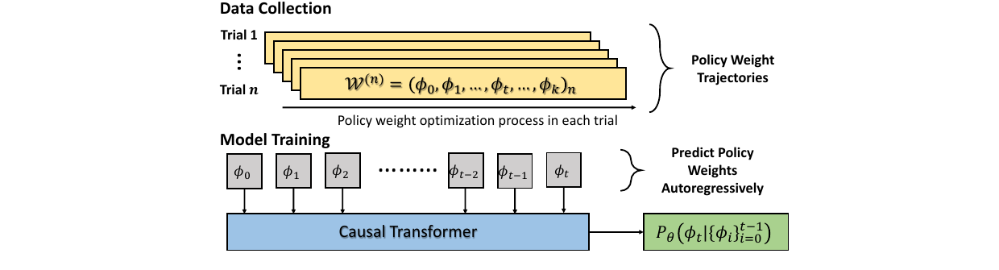
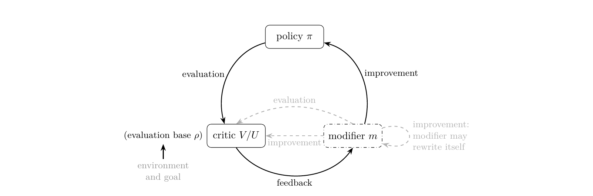

How should a large model keep learning from the new data produced by a changing world? Through naive post-training fine-tuning, through in-context learning, or through in-parameter learning?

This short post gives a quick, clear comparison of four ways for a model to exploit a context $c$ (a long document, an interaction history, or any learnable form of data): represent $c$ as a prompt (ICL), as full parameters (per-context SFT), as low-rank parameters (per-context LoRA SFT), or generate low-rank parameters in a single forward pass with a hypernetwork (in-parameter learning, as in SHINE [1]). The point is not which one is better, but what $c$ is represented as, how it is produced, and what it costs. At the end, the post also discusses update by inference, and whether SHINE—a representative in-parameter learning method—counts as RSI under the Generalized Agent Iteration framework.

> ICL leaves the context in the tokens; SFT optimizes it into the weights; LoRA compresses it into a low-rank subspace; SHINE generates it in a single forward pass. These four are not replacements for one another; they are four representations of context.

## 1. Problem Setup: A Batch of Contexts, Four Representations

Given $N$ documents $c_1,\dots,c_N$, each with a set of questions $D_i=\{(q,a)\}$. The goal is always to use $c_i$ to answer $D_i$; the difference is what $c_i$ is represented as:

- **ICL**: represent $c_i$ as a prompt / KV cache;
- **Per-context full SFT**: represent $c_i$ as full parameters $\Delta\theta_i$;
- **Per-context LoRA SFT**: represent $c_i$ as low-rank parameters $\Delta\theta_i$;
- **SHINE**: use a shared generator $f_\phi$ to represent $c_i$ as generated low-rank parameters $\Delta\theta_i$.

In addition, **global SFT**—training a single $\Delta\theta$ on all training documents mixed together—serves as a reference: it never sees the test documents, and only illustrates the limit of "one model for all documents."

Two axes need to be kept separate: **parametrization** (full parameters vs. LoRA) and **scope** (global vs. per-context). Mixing them up will distort the comparison later.

| Parametrization \ scope | Global: one update for all $c$ | Per-context: one update per $c$ |
|---|---|---|
| **Full parameters** | global full SFT: one $\Delta\theta$ trained on all documents | per-context full SFT: solve an $\arg\min$ per document (capacity upper bound, reference only) |
| **LoRA** | global LoRA SFT: one LoRA trained on all documents | per-context LoRA SFT: **optimize** an adapter per document on the fly SHINE: **generate** an adapter per document, no gradients |

Reading: rows are **parametrization**, columns are **scope**. SHINE is not a separate third row—it sits in the same bottom-right cell as per-context LoRA SFT. Both are "one LoRA per document"; the only difference is whether the adapter is optimized (SFT) or produced by a single forward pass of a generator (SHINE). ICL sits outside the table: it performs no weight update, and $c_i$ stays in the prompt / KV cache.

At evaluation time, documents are split into train and test sets. Test documents are not used in SHINE's meta-training or in global SFT's training. Per-context SFT methods optimize on a support set, and all methods are evaluated on held-out queries. ICL puts the test document in the prompt; SHINE only generates a LoRA for the test document without gradients; global SFT never sees the test document and serves only as a reference. The key question is not "who scores higher," but whether these methods **can see the new document at test time, and whether they optimize on it**.

## 2. ICL vs. SFT vs. IPL

| Dimension | ICL | Per-context full SFT | Per-context LoRA SFT | SHINE |
|---|---|---|---|---|
| Context representation | token / KV cache | full parameters | per-document LoRA | generated per-document LoRA |
| How it is produced | prefill | per-context optimization | per-context optimization | one forward pass |
| Sees new document at test time | yes | yes (support) | yes (support) | yes (generator input) |
| Test-time optimization | no | yes | yes | no |
| Main error | context window / latency | overfitting / high variance | rank gap / overfitting | amortization gap / OOD |

Global SFT is not in the table; it never sees the test document and is only a reference. Per-context full-parameter SFT is an upper bound on capacity (training loss), not on generalization, and is rarely done per document in practice; the paper's actual baseline is per-context LoRA SFT, which optimizes a rank-8 LoRA per document on the fly. Like SHINE, it uses "one adapter per document"; the difference is whether the adapter is optimized or generated in a single forward pass.

This line of work did not start with SHINE: Generative Adapter [2] already writes context into an adapter in a single forward pass, differing in coverage and generator architecture; SHINE's main changes are full-layer + M2P + larger-scale meta-training.

### 2.1 A Formal Comparison

Let $\theta_0$ be a frozen base model, $\mathcal{M}$ the full parameter space, $\mathcal{M}_r$ the rank-$r$ LoRA update space, and $L_i(\Delta\theta)$ a conceptual objective loss. For brevity, the formulas below do not distinguish train/test documents or support/held-out; the actual evaluation follows the setup in the previous section.

ICL performs no weight update and directly conditions on $c_i$:

$$\text{ICL:}\quad p_{\theta_0}(a \mid c_i,q).$$

Global SFT uses one update to serve all training documents:

$$\text{Global SFT:}\quad \Delta\theta^\star = \arg\min_{\Delta\theta} \frac{1}{N}\sum_{i=1}^N L_i(\Delta\theta).$$

Per-context SFT solves an argmin for each document:

$$\text{Per-context SFT:}\quad \Delta\theta_i^\star = \arg\min_{\Delta\theta} L_i(\Delta\theta).$$

SHINE learns a generator that maps each document to an update:

$$\text{SHINE:}\quad \phi^\star = \arg\min_{\phi} \frac{1}{N}\sum_{i=1}^N L_i(f_\phi(c_i)).$$

The difference between these approaches can be compressed into one sentence:

> Global SFT is "one min for all documents"; per-context SFT is "one min per document"; SHINE is "one min over $\phi$, with each document's $f_\phi(c_i)$ inside"; ICL has no min at adaptation time—$c_i$ stays in the input.

### 2.2 Two Gaps

For per-context methods, we can write a three-level inequality:

$$\frac{1}{N}\sum_i \min_{\Delta\theta\in\mathcal{M}} L_i(\Delta\theta)\;\le\;\frac{1}{N}\sum_i \min_{\Delta\theta\in\mathcal{M}_r} L_i(\Delta\theta)\;\le\;\min_{\phi}\frac{1}{N}\sum_i L_i(f_\phi(c_i)).$$

The left side is the per-context optimum of full-parameter SFT (oracle), the middle is per-context LoRA SFT, and the right side is SHINE. Global SFT is not in this inequality: it trains a single $\Delta\theta$ on all training documents mixed together, with objective $\min_{\Delta\theta}\frac{1}{N}\sum_i L_i(\Delta\theta)$; its advantage is that one model serves all documents, with simple storage and deployment; its disadvantage is that documents can conflict. The two gaps are:

1. **rank gap**: from full parameters to low-rank LoRA, losing parameter capacity;
2. **amortization gap**: from per-context optimization to single-forward generation, losing per-context optimality.

The "cost of one forward pass" in this post refers to the second gap.

The SHINE paper fixes the rank of the generated LoRA at 8, and the per-context LoRA SFT baseline is also rank 8, so it mainly studies the second gap: **given the same low-rank capacity, optimized updates vs. generated updates**.

Geometrically, with $\phi$ fixed, SHINE's solution is constrained to the submanifold $f_\phi(\mathcal{C})$ rather than the entire LoRA space, where $\mathcal{C}$ is the document space the generator sees. In their NeurIPS 2026 geometry study, Yang et al. [3] observe that generated LoRAs have highly concentrated spectra and are strongly aligned with each other, whereas per-context LoRA SFT updates are more diffuse and nearly orthogonal.

In other words:

> SHINE does not search for a solution in the free LoRA space; it searches in a low-dimensional solution space defined by the generator.

### 2.3 What the Geometric Difference Means

**Spectral concentration + strong alignment** means:

- different documents' generated LoRAs share a set of principal directions;
- the updates have lower effective rank and a more compact structure;
- the generator learns a shared low-dimensional "document → update" structure.

**Spectral diffuseness + near-orthogonality** means:

- per-context LoRA SFT updates for different documents are more independent;
- update directions spread out more, with higher effective degrees of freedom;
- each document can get closer to its own optimum.

This is a **bias-variance / capacity-vs-specificity** trade-off, not "SHINE is better because it is more structured"; Section 3 discusses the practical boundary.

The cost of alignment is potential contention for the shared subspace; the cost of diffuseness is that it is harder to compress and share structure. This also shows that SHINE's bottleneck is not only the rank-8 capacity but also the coverage of the generator's image: if a document's optimal update falls outside the image, a single forward pass will never reach it, no matter how fast it is.

## 3. When May ICL, SFT or IPL Work Better?

The formal comparison above gives two axes: whether the model can see $c$ at test time, and whether it is allowed to optimize on the test context; for parametric methods, whether the solution space is the free LoRA space or the generator-constrained image. Combining these axes with the geometric differences yields a rough applicability boundary.

**ICL is more likely to win** when:

- the context fits in the window, the number of queries is small, or exact citation and auditability are required;
- the task demands strong OOD generalization, long-tail facts, or frequently changing contexts;
- you do not want to maintain an adapter per context.

Its costs are prefill / KV cache and lost-in-the-middle in long contexts.

**Per-context SFT is more likely to win** when:

- each context has enough support data for tens to hundreds of optimization steps;
- contexts differ greatly and optimal update directions are not shared;
- a single context needs to be fit to very high precision.

Its costs are per-context optimization, storing $N$ updates (especially heavy for full SFT), and variance and overfitting with small data.

**IPL / SHINE is more likely to win** when:

- there are many contexts and repeated queries, so the fixed cost of generating adapters can be amortized;
- contexts share strong structure and each context has little support data;
- you can accept the amortization gap of a single forward pass in exchange for a unified generator and low latency.

Its risks are that the generator's image may not cover OOD or unique updates, and that the low-rank bottleneck limits exact recall.

**Global SFT** suits a different setting: all contexts share the same knowledge or behavior, and you want to deploy only one model; if contexts conflict strongly, it sacrifices per-context performance through the average loss.

This is not about one method replacing another, but about trading off failure modes: ICL fears contexts that are too long, per-context SFT fears too little data or too-expensive optimization per context, and IPL fears the generator not covering the update. The geometric fingerprint—spectral concentration/alignment vs. diffuseness/orthogonality—is an empirical signature of this trade-off.

## 4. Conclusion

SHINE is a **learned compiler / amortized optimizer**. It turns per-context optimization into a cross-document function-learning problem, trading the amortization gap for a single forward pass. It suits many documents, repeated queries, and stable corpora; it does not suit one-off, strongly OOD, exact-recall, or long-horizon procedural tasks.

ICL, per-context full-parameter SFT, per-context LoRA SFT, and SHINE are not replacements for one another; they are four representations of context. SHINE is not a replacement for per-context SFT, but an amortization point on the spectrum of "compiling context into parameters."

## 5. Additional Discussion

### 5.1 Update by Inference: Similarity to TIPL

TIPL [4] (Tang, 2025) views the training process of an RL policy network as a weight trajectory: feed the sequence of historical policy weights to a causal Transformer and autoregressively predict the next set of policy weights; at inference time, replace iterative gradient updates with a forward prediction. Abstractly, it is very similar to SHINE: **both learn "optimization" as a forward function**, amortizing each on-the-fly gradient update into offline training.

*Figure 1: TIPL treats the policy-weight trajectory as a sequence and autoregressively predicts the next set of weights with a causal Transformer (Tang, 2025).*

But the two optimize different objects under different conditions:

- TIPL is conditioned on the **weight history**, outputs **full policy weights**, and is trained with next-weight MSE; it is more like a **weight-space dynamics model / learned optimizer**.
- SHINE is conditioned on the **textual context**, outputs a **low-rank LoRA**, and is trained with reconstruction / QA loss; it is more like a **context-to-parameter compiler**.
- TIPL performs autoregressive multi-step prediction; SHINE generates one adapter in a single forward pass.

So the similarity is at the level of "forward pass instead of gradients"; the difference is what condition, what parameters, and what training signal. TIPL learns an optimization trajectory; SHINE learns a context-to-parameter mapping.

### 5.2 SHINE through the GAI Framework

GAI [5] (Tang et al., 2026) decomposes a system into $\pi, V, m, U, \rho$: $\pi$ is the policy, $V$ is the action critic, $m$ is the modifier (proposing how the system changes), $U$ is the modification critic, and $\rho$ is the evaluation criterion; the agent $\mathrm{Ag}$ is the part of the system that can be modified. It uses two dials to distinguish iterative systems:

- **Dial 1**: Is the modifier $m$ inside the agent $\mathrm{Ag}$? If $m \notin \mathrm{Ag}$, the improvement mechanism is fixed outside the agent, and the system is a fixed outer loop / GPI; if $m \in \mathrm{Ag}$, the system can rewrite its own modifier and enters RSI.
- **Dial 2**: Is the evaluation criterion $\rho$ anchored by the external world? If $\rho$ is externally anchored, the system is Anchored; if $\rho$ can also be rewritten by the agent, it enters Goal Drift or Fully Self-Referential.

*Figure 2: GAI's policy / critic / modifier loop; when the modifier is fixed outside the agent it degenerates to GPI, and when the modifier is inside the agent it is RSI (Tang et al., 2026).*

Put SHINE into this framework:

- $\pi$: the base LLM with the generated LoRA;
- one substrate of $m$: the SHINE hypernetwork (context → LoRA update), fixed after training;
- $U$: there is no modification critic at deployment; SHINE generates open-loop, and the reconstruction / QA loss at training time is only used for offline learning;
- $\rho$: the reconstruction / QA objective and held-out data, externally anchored;
- $\mathrm{Ag}$: the generated adapter ($\pi$ is realized by the frozen base plus adapter); $m \notin \mathrm{Ag}$.

Applying the two dials to SHINE: in Dial 1, $m$ is the hypernetwork fixed after training, $m \notin \mathrm{Ag}$, so it is a fixed outer loop / GPI, not RSI; in Dial 2, $\rho$ is the external QA/reconstruction objective, so it is Anchored. Together, SHINE is **Anchored GPI (fixed outer loop)**, corresponding to the "fixed outer loops" class in Table 3. It changes the agent's adapter but not the modifier itself—GAI's first dial asks whether $m$ can be modified, not whether the agent's weights change.

More precisely, SHINE does learn an **optimizer**—a context-conditioned, amortized parameter-update rule; but it is not a complete modifier, only the **parameter-update component** of a modifier. GAI's modifier can be a pipeline (task proposer, experience store, trainer, schedule); SHINE implements only the context → parameter update segment. As a trained module, it does not decide what to learn, when to update, or how to evaluate.

If someday SHINE's hypernetwork itself is also updated online based on the agent's experience and evaluation ($m \in \mathrm{Ag}$), then it might enter the discussion of Anchored RSI; the current version of SHINE is not.

---

## 6. References

**[1]** Yewei Liu, Xiyuan Wang, Yansheng Mao, Yoav Gelberg, Haggai Maron, and Muhan Zhang.  
*SHINE: A Scalable In-Context Hypernetwork for Mapping Context to LoRA in a Single Pass.*  
ICML 2026. [arXiv:2602.06358](https://arxiv.org/abs/2602.06358)

**[2]** Tong Chen, Hao Fang, Patrick Xia, Xiaodong Liu, Benjamin Van Durme, Luke Zettlemoyer, Jianfeng Gao, and Hao Cheng.  
*Generative Adapter: Contextualizing Language Models in Parameters with A Single Forward Pass.*  
ICLR 2025. [arXiv:2411.05877](https://arxiv.org/abs/2411.05877)

**[3]** Yanlai Yang, Minki Kang, Divyam Madaan, Sung Ju Hwang, and Mengye Ren.  
*On the Geometry and Latent-Space Composition of Hypernetwork-Generated LoRAs.*  
NeurIPS 2026. [NeurIPS](https://neurips.cc/virtual/2026/loc/atlanta/poster/148858)

**[4]** Hongyao Tang.  
*Can We Optimize Deep RL Policy Weights as Trajectory Modeling?*  
ICLR 2025 WSL. [arXiv:2503.04074](https://arxiv.org/abs/2503.04074)

**[5]** Hongyao Tang, Yi Ma, Pengyi Li, and Yifu Yuan.  
*Generalized Agent Iteration: One Formal Framework for Iterative Policy Improvement and Recursive Self-Improvement.*  
arXiv 2026. [arXiv:2609.13406](https://arxiv.org/abs/2609.13406)
