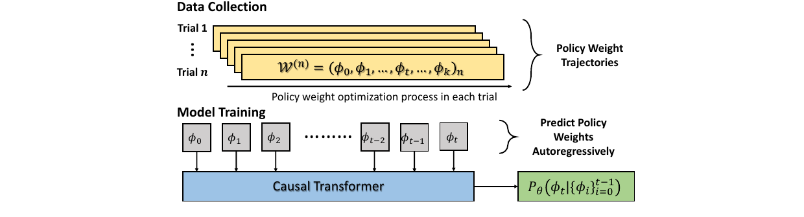
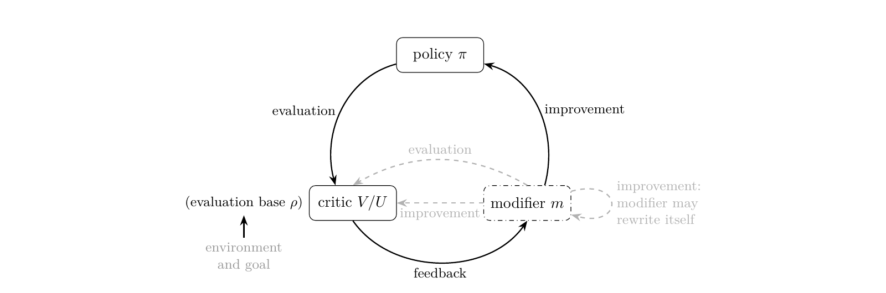

对于变化世界产生的新数据，大模型应该如何持续从数据中进行学习？是通过朴素的后训练微调，通过 in-context learning，还是 in-parameter learning？

这篇短文对四种让模型利用上下文 $c$（一段长文档、一段交互历史、或是任意可学习的数据形式）的方式进行一个快速、清晰的比较：把 $c$ 表示成 prompt（ICL）、全量参数（逐上下文 SFT）、低秩参数（逐上下文 LoRA SFT），或用超网络一次前向生成低秩参数（SHINE [1] 这类 in-parameter learning）。重点不是谁更好，而是 $c$ 被表示成什么、如何产生、代价是什么。此外，文章末尾会额外讨论 update by inference，以及 in-parameter learning 的代表性工作 SHINE 在 Generalized Agent Iteration 框架下是否属于 RSI 的判别。

> ICL 把上下文留在 token 里，SFT 把它优化进权重，LoRA 把它压进低秩子空间，SHINE 则用一次前向把它生成出来。四者不是替代关系，而是上下文的四种表示。

## 1. 问题设定：一批上下文，四种表示

给定 $N$ 篇文档 $c_1,\dots,c_N$，每篇文档带一组问题 $D_i=\{(q,a)\}$。目标都是利用 $c_i$ 回答 $D_i$；区别在于 $c_i$ 被表示成什么：

- **ICL**：把 $c_i$ 表示成 prompt / KV cache；
- **逐上下文全参数 SFT**：把 $c_i$ 表示成全量参数 $\Delta\theta_i$；
- **逐上下文 LoRA SFT**：把 $c_i$ 表示成低秩参数 $\Delta\theta_i$；
- **SHINE**：用共享生成器 $f_\phi$ 把 $c_i$ 表示成生成的低秩参数 $\Delta\theta_i$。

此外，把所有训练文档混在一起训练一个 $\Delta\theta$ 的**全局 SFT** 作为参照：它看不到测试文档，只用于说明“一个模型服务所有文档”的极限。

这里需要区分两个轴：**参数化**（全参数 vs LoRA）与 **scope**（全局 vs 逐上下文）。混在一起会让后面的比较失真。

| 参数化 \ scope | 全局：一个更新服务所有 $c$ | 逐上下文：每个 $c$ 一个更新 |
|---|---|---|
| **全参数** | global full SFT：一个 $\Delta\theta$ 混训所有文档 | per-context full SFT：每篇文档解一个 $\arg\min$（容量上界，仅作参照） |
| **LoRA** | global LoRA SFT：一个 LoRA 混训所有文档 | per-context LoRA SFT：每篇文档现场**优化**一个 adapter SHINE：每篇文档**生成**一个 adapter，不做梯度 |

读法：按行看**参数化**，按列看 **scope**。SHINE 不是单独的第三行——它和 per-context LoRA SFT 同在右下角一格，都是“每篇文档一个 LoRA”，区别只在 adapter 是优化出来的（SFT）还是由生成器一次前向产生（SHINE）。ICL 放在表外：它不做权重更新，$c_i$ 留在 prompt / KV cache 里。

评估时，文档分成训练集和测试集；测试文档不参与 SHINE 的元训练，也不参与全局 SFT 的训练。逐上下文 SFT 类方法在 support set 上优化，所有方法在 held-out queries 上评估。ICL 把测试文档放进 prompt；SHINE 只为测试文档生成 LoRA、不做梯度；全局 SFT 看不到测试文档，只作为参照。这里的关键不是“谁分数高”，而是这些方法在测试时**能不能看到新文档、是否在新文档上优化**。

## 2. ICL vs. SFT vs. IPL

| 维度 | ICL | 逐上下文全参数 SFT | 逐上下文 LoRA SFT | SHINE |
|---|---|---|---|---|
| 上下文表示 | token / KV cache | 全量参数 | 每篇文档的 LoRA | 生成的每篇文档 LoRA |
| 如何产生 | prefill | 逐上下文优化 | 逐上下文优化 | 一次前向生成 |
| 测试时看到新文档 | 是 | 是（support） | 是（support） | 是（generator 输入） |
| 测试时优化 | 否 | 是 | 是 | 否 |
| 主要误差 | 上下文窗口 / 延迟 | 过拟合 / 高方差 | rank gap / 过拟合 | amortization gap / OOD |

表中没有列全局 SFT；它看不到测试文档，只作为参照。逐上下文全参数 SFT 是容量（训练损失）上界，不是泛化上界，实践中也很少逐文档做；论文的实际 baseline 是逐上下文 LoRA SFT：每篇文档现场优化一个 rank-8 LoRA；它和 SHINE 一样，都是“每篇文档一个 adapter”，区别在于 adapter 是优化出来的，还是一次前向生成的。

这条路线并不是从 SHINE 开始的：Generative Adapter [2] 已经用一次前向把 context 写进 adapter，只是覆盖范围和生成器结构不同；SHINE 的主要变化是 full-layer + M2P + 更大规模元训练。

### 2.1 形式化比较

设 $\theta_0$ 是冻结基座，$\mathcal{M}$ 是全参数空间，$\mathcal{M}_r$ 是 rank-$r$ 的 LoRA 更新空间，$L_i(\Delta\theta)$ 是概念性的目标损失。为简洁，下面的公式不区分训练/测试文档，也不区分 support / held-out；实际评估按上一节的设定。

ICL 没有权重更新，它直接条件在 $c_i$ 上：

$$\text{ICL:}\quad p_{\theta_0}(a \mid c_i,q).$$

全局 SFT 用一个更新服务所有训练文档：

$$\text{Global SFT:}\quad \Delta\theta^\star = \arg\min_{\Delta\theta} \frac{1}{N}\sum_{i=1}^N L_i(\Delta\theta).$$

逐上下文 SFT 为每篇文档解一个 argmin：

$$\text{Per-context SFT:}\quad \Delta\theta_i^\star = \arg\min_{\Delta\theta} L_i(\Delta\theta).$$

SHINE 学一个生成器，把每篇文档映射成一个更新：

$$\text{SHINE:}\quad \phi^\star = \arg\min_{\phi} \frac{1}{N}\sum_{i=1}^N L_i(f_\phi(c_i)).$$

这些做法的区别可以压缩成一句话：

> 全局 SFT 是“一个 min 管所有文档”；逐上下文 SFT 是“每篇文档一个 min”；SHINE 是“一个 min over $\phi$，里面套着每篇文档的 $f_\phi(c_i)$”；ICL 在适配阶段没有 min，$c_i$ 留在输入里。

### 2.2 两个 gap

对逐上下文方法，可以写出一个三层不等式：

$$\frac{1}{N}\sum_i \min_{\Delta\theta\in\mathcal{M}} L_i(\Delta\theta)\;\le\;\frac{1}{N}\sum_i \min_{\Delta\theta\in\mathcal{M}_r} L_i(\Delta\theta)\;\le\;\min_{\phi}\frac{1}{N}\sum_i L_i(f_\phi(c_i)).$$

左边是全参数 SFT 的逐上下文最优（oracle），中间是逐上下文 LoRA SFT，右边是 SHINE。全局 SFT 不在这条不等式里：它把所有训练文档混在一起训练一个 $\Delta\theta$，目标是 $\min_{\Delta\theta}\frac{1}{N}\sum_i L_i(\Delta\theta)$；它的优势是一个模型服务所有文档，存储/部署简单；劣势是文档之间会冲突。两个 gap：

1. **rank gap**：全参数 → 低秩 LoRA，损失的是参数容量；
2. **amortization gap**：逐上下文优化 → 一次前向生成，损失的是逐上下文最优性。

本文说的“一次前向的代价”，指的就是第二个 gap。

SHINE 论文把生成 LoRA 的 rank 固定为 8，逐上下文 LoRA SFT baseline 也是 rank 8，所以它主要在研究第二个 gap：**同样的低秩容量，优化出来的更新 vs 生成出来的更新**。

几何上，固定 $\phi$ 时，SHINE 的解被限制在 $f_\phi(\mathcal{C})$ 这个子流形上，而不是整个 LoRA 空间，其中 $\mathcal{C}$ 是生成器面对的文档空间。Yang et al. [3] 在 NeurIPS 2026 的几何研究里观察到：生成 LoRA 谱高度集中、彼此强对齐；逐上下文 LoRA SFT 则更弥散、近乎正交。

换句话说：

> SHINE 并不在自由的 LoRA 空间里找解，而是在由生成器定义的低维解空间里找解。

### 2.3 几何差异的含义

**谱集中 + 强对齐** 意味着：

- 不同文档生成的 LoRA 共享一组主要方向；
- 更新的有效秩较低，结构更紧凑；
- 生成器学到的是一种“文档 → 更新”的共享低维结构。

**谱弥散 + 近乎正交** 意味着：

- 每篇文档的逐上下文 LoRA SFT 更新更独立；
- 更新方向铺得更开，有效自由度更高；
- 每篇文档可以更贴近自己的最优解。

这是一种 **bias-variance / 容量与特异性** 的 trade-off，而非“SHINE 更结构化，所以更好”；具体适用边界在第 3 节展开。

对齐的代价是共享子空间可能争用；弥散的代价是更难压缩、更难共享结构。这也说明，SHINE 的瓶颈不只是 rank-8 的容量，还有生成器 image 的覆盖范围：如果某篇文档的最优更新落在 image 之外，一次前向再快也到不了。

## 3. When may ICL, SFT or IPL work better?

上面的形式化比较给了两个判断维度：测试时能不能看到 $c$、是否允许在测试上下文上优化；对参数方法，再看解空间是自由的 LoRA 空间，还是被生成器约束的 image。把这两个维度和几何差异放在一起，可以得到一个粗略的适用边界。

**ICL 更容易占优**，当：

- context 能放进窗口，查询次数不多，或者需要精确引用、可审计；
- 任务要求强 OOD、长尾事实、上下文频繁变化；
- 不想维护每个上下文的 adapter。

它的代价是 prefill / KV cache，以及长上下文里的 lost-in-the-middle。

**逐上下文 SFT 更容易占优**，当：

- 每个上下文有足够的 support 数据，可以做几十到几百步优化；
- 上下文之间差异大，最优更新方向不共享；
- 需要把单个上下文拟合到很高的精度。

它的代价是逐上下文优化成本、存储 N 个更新（full SFT 尤其重），以及小数据下的方差和过拟合。

**IPL / SHINE 更容易占优**，当：

- 上下文数量多、重复查询多，生成 adapter 的固定成本可以被摊薄；
- 上下文之间共享结构强，每个上下文的 support 数据少；
- 可以接受一次前向的 amortization gap，换取统一生成器和低延迟。

它的风险是生成器 image 覆盖不到 OOD 或独特的更新，以及低秩 bottleneck 对精确召回的限制。

**全局 SFT** 则适合另一种场景：所有上下文共享同一套知识或行为，且希望只部署一个模型；如果上下文之间冲突大，它会用平均损失牺牲单个上下文的效果。

这不是谁替代谁，而是几种失败模式的对调：ICL 怕 context 太长，逐上下文 SFT 怕每个上下文的数据太少或优化太贵，IPL 怕生成器没覆盖到。几何上的“谱集中 / 对齐 vs 弥散 / 正交”正是这个 trade-off 的一个经验指纹。

## 4. 结论

SHINE 是一个 **learned compiler / amortized optimizer**。它把逐上下文的优化问题变成了跨文档的函数学习问题，用 amortization gap 换取一次前向。它适合多文档、重复查询、稳定语料；不适合一次性、强 OOD、精确召回、长程过程性任务。

ICL、逐上下文全参数 SFT、逐上下文 LoRA SFT、SHINE 不是替代关系，而是四种上下文表示。SHINE 不是逐上下文 SFT 的替代品，而是“把上下文编译成参数”这条谱系上的一个摊销点。

## 5. 额外讨论

### 5.1 Update by Inference: 和 TIPL 的相似性

TIPL [4]（Tang, 2025）把 RL 策略网络的训练过程看成一条权重轨迹：把历史策略权重序列喂给 causal Transformer，自回归预测下一组策略权重；推理时用前向预测代替迭代梯度更新。它和 SHINE 在抽象层面很像：**都把“优化”学成了一个前向函数**，把每次现算的梯度更新摊销到离线训练里。

*图 1：TIPL 将策略权重轨迹作为序列，用 causal Transformer 自回归预测下一组权重（Tang, 2025）。*

但两者优化的对象和条件不同：

- TIPL 的条件是**权重历史**，输出是**完整策略权重**，训练信号是 next-weight MSE；它更像一个 **weight-space dynamics model / learned optimizer**。
- SHINE 的条件是**文本 context**，输出是**低秩 LoRA**，训练信号是 reconstruction / QA loss；它更像一个 **context-to-parameter compiler**。
- TIPL 是自回归多步预测，SHINE 是一次前向生成一个 adapter。

所以，相似性在“前向代替梯度”这一层；差别在“从什么条件、生成什么参数、用什么信号训练”。TIPL 学的是优化轨迹，SHINE 学的是上下文到参数的映射。

### 5.2 在 GAI 框架下看 SHINE

GAI [5]（Tang et al., 2026）把系统拆成 $\pi, V, m, U, \rho$：$\pi$ 是策略，$V$ 是 action critic，$m$ 是 modifier（提出系统如何改变），$U$ 是 modification critic，$\rho$ 是评估基准；agent $\mathrm{Ag}$ 是系统里可修改的部分。它用两个 dial 区分不同的迭代系统：

- **Dial 1**：modifier $m$ 是否在 agent $\mathrm{Ag}$ 内？如果 $m \notin \mathrm{Ag}$，改进机制固定在 agent 外，系统是 fixed outer loop / GPI；如果 $m \in \mathrm{Ag}$，系统可以改写自己的 modifier，才进入 RSI。
- **Dial 2**：评估基准 $\rho$ 是否由外部世界锚定？如果 $\rho$ 外部锚定，系统是 Anchored；如果 $\rho$ 也被 agent 改写，则进入 Goal Drift 或 Fully Self-Referential。

*图 2：GAI 的 policy / critic / modifier 循环；modifier 固定在 agent 外时退化为 GPI，modifier 在 agent 内时是 RSI（Tang et al., 2026）。*

把 SHINE 放进去：

- $\pi$：带生成 LoRA 的基座 LLM；
- $m$ 的一个 substrate：SHINE 超网络（context → LoRA update），训练后固定；
- $U$：部署时没有 modification critic；SHINE 是开环生成，训练时的 reconstruction / QA loss 只用于离线学习；
- $\rho$：reconstruction / QA 目标与 held-out 数据，外部锚定；
- $\mathrm{Ag}$：生成的 adapter（$\pi$ 由冻结基座 + adapter 实现）；$m \notin \mathrm{Ag}$。

把这两个 dial 应用到 SHINE：Dial 1 里，$m$ 是训练后固定的超网络，$m \notin \mathrm{Ag}$，所以它是 fixed outer loop / GPI，不是 RSI；Dial 2 里，$\rho$ 是外部 QA/reconstruction 目标，所以是 Anchored。合起来，SHINE 是 **Anchored GPI（fixed outer loop）**，对应 Table 3 的 “fixed outer loops” 类。它改变 agent 的 adapter，但不改变 modifier 本身——GAI 的第一个 dial 问的是 $m$ 是否可修改，不是 agent 的权重是否变化。

更细一点：在这个意义上，SHINE 学的确实是一个 **optimizer**——一个 context-conditioned、amortized 的参数更新规则；但它不是“完整的 modifier”，而是 modifier 的**参数更新组件**。GAI 的 modifier 可以是一个 pipeline（task proposer、experience store、trainer、schedule）；SHINE 只实现了其中的 context → parameter update 这一段。作为一个已训练好的模块，它不决定学什么、何时更新、如何评估。

如果哪天 SHINE 的超网络本身也根据 agent 的经验和评估在线更新（$m \in \mathrm{Ag}$），那它才可能进入 Anchored RSI 的讨论；当前版本的 SHINE 不是。

---

## 6. 参考文献

**[1]** Yewei Liu, Xiyuan Wang, Yansheng Mao, Yoav Gelberg, Haggai Maron, and Muhan Zhang.  
*SHINE: A Scalable In-Context Hypernetwork for Mapping Context to LoRA in a Single Pass.*  
ICML 2026. [arXiv:2602.06358](https://arxiv.org/abs/2602.06358)

**[2]** Tong Chen, Hao Fang, Patrick Xia, Xiaodong Liu, Benjamin Van Durme, Luke Zettlemoyer, Jianfeng Gao, and Hao Cheng.  
*Generative Adapter: Contextualizing Language Models in Parameters with A Single Forward Pass.*  
ICLR 2025. [arXiv:2411.05877](https://arxiv.org/abs/2411.05877)

**[3]** Yanlai Yang, Minki Kang, Divyam Madaan, Sung Ju Hwang, and Mengye Ren.  
*On the Geometry and Latent-Space Composition of Hypernetwork-Generated LoRAs.*  
NeurIPS 2026. [NeurIPS](https://neurips.cc/virtual/2026/loc/atlanta/poster/148858)

**[4]** Hongyao Tang.  
*Can We Optimize Deep RL Policy Weights as Trajectory Modeling?*  
ICLR 2025 WSL. [arXiv:2503.04074](https://arxiv.org/abs/2503.04074)

**[5]** Hongyao Tang, Yi Ma, Pengyi Li, and Yifu Yuan.  
*Generalized Agent Iteration: One Formal Framework for Iterative Policy Improvement and Recursive Self-Improvement.*  
arXiv 2026. [arXiv:2609.13406](https://arxiv.org/abs/2609.13406)
